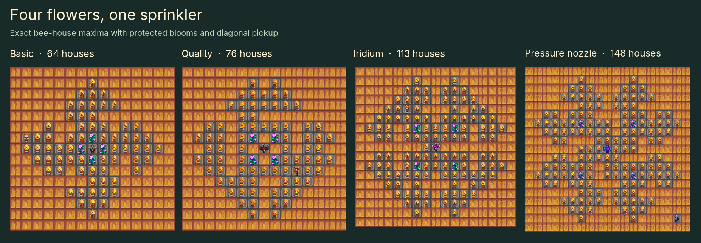
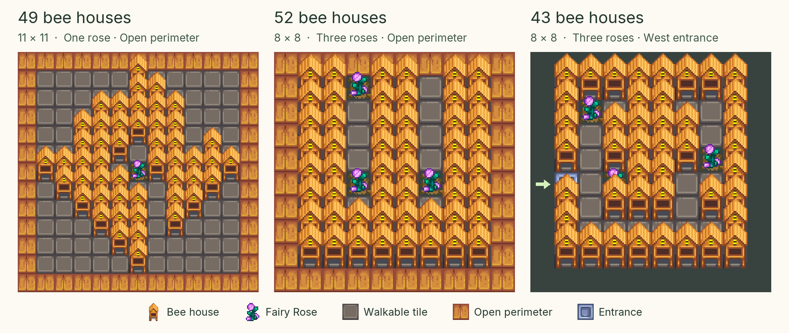
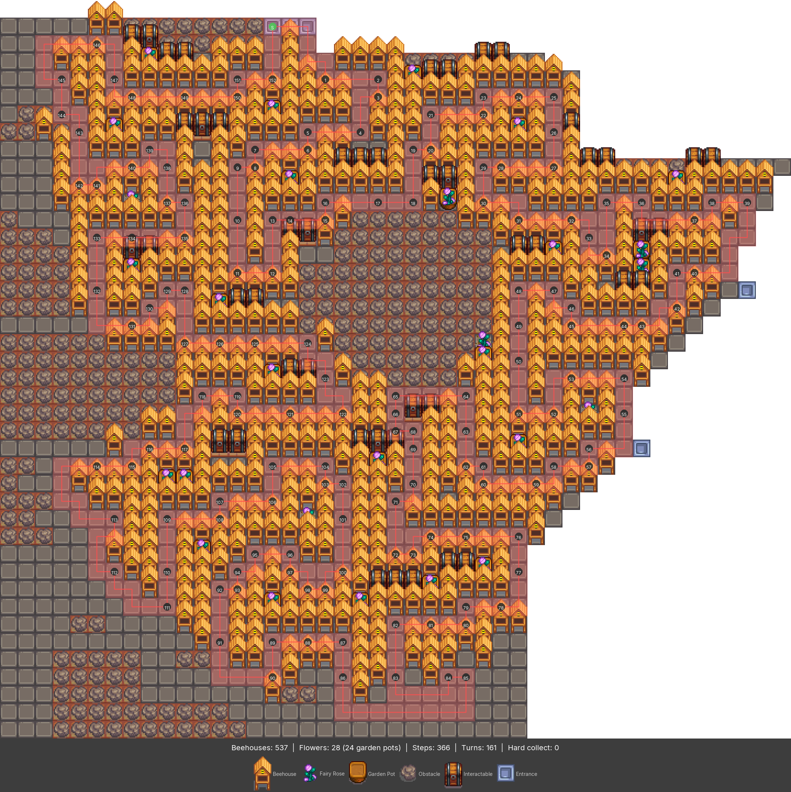
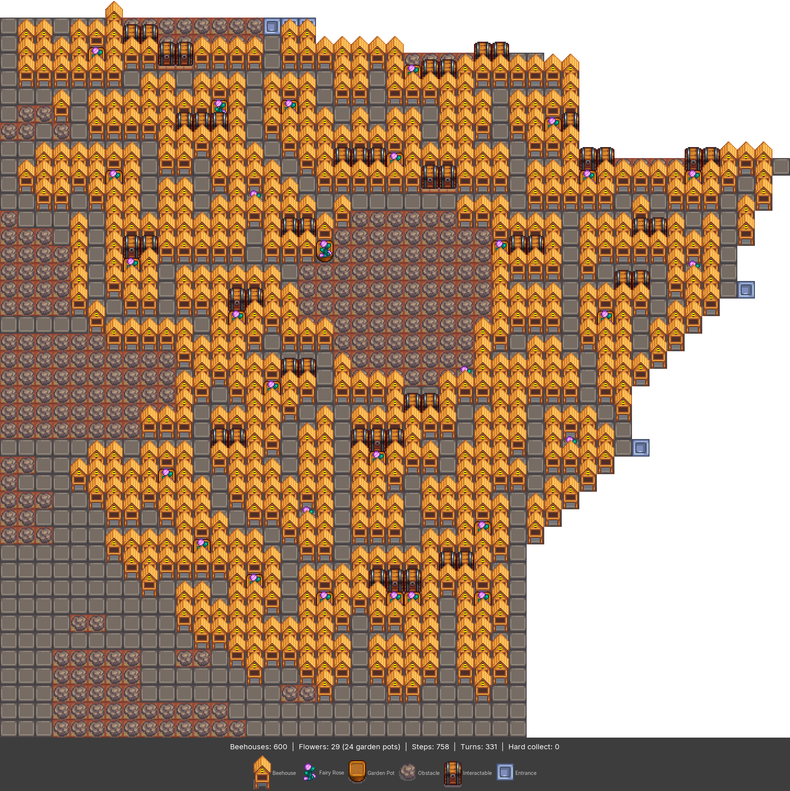
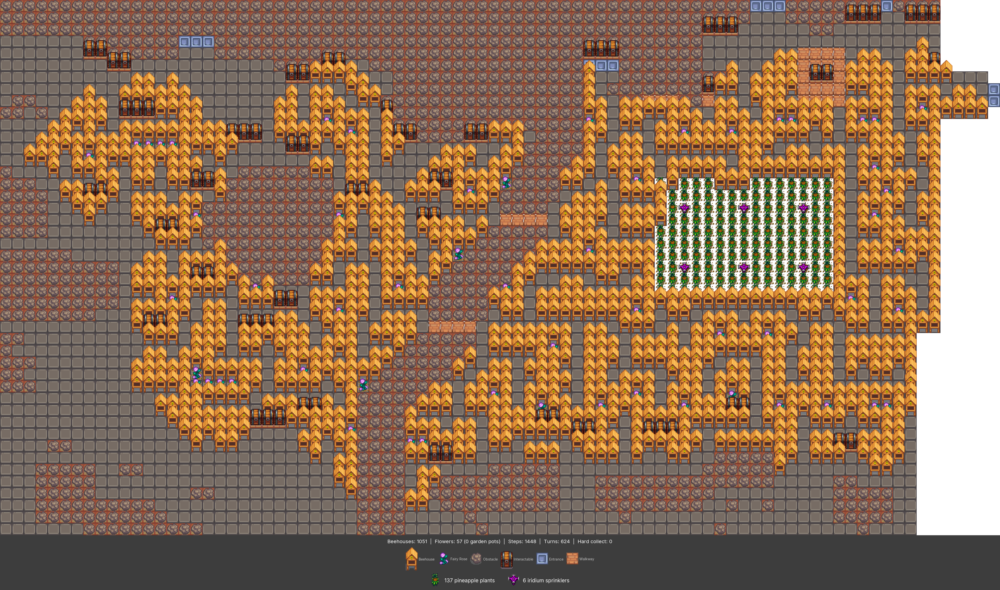
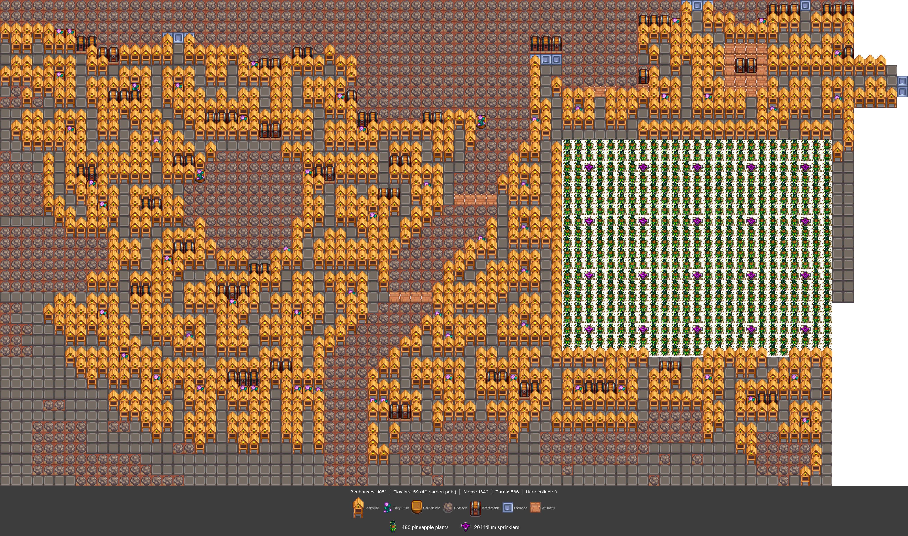

# Opti-Harvest

Opti-Harvest uses CP-SAT to design Stardew Valley apiaries where every bee house produces flower honey and every jar is reachable. You can [copy a build](#build-gallery), [explore the optimization model](#optimization-model), or [run the solver](#run-the-solver) on a plot of your own.

## Build gallery

Open an image for the full-size map. Follow its title for the tile plan, collection rules and build instructions.

[Small plots](#small-plots) · [One-lap harvests](#one-lap-harvests) · [Growing in stages](#growing-in-stages) · [Ginger Island West](#ginger-island-west) · [Million-gold harvests](#million-gold-harvests)

### Small plots

<table>
<tr>
<td width="50%" valign="top">

**[148 houses with four Fairy Roses](examples/pressure-nozzle/README.md#148-houses-with-four-roses)**

[](examples/pressure-nozzle/nozzle-four.png)

Plant a rose at each corner of one sprinkler’s 7×7 watering square. All four stay safe from accidental picking, and the 19×19 footprint includes the outer walking lane.

[Tile plan](examples/pressure-nozzle/nozzle-four.txt) · [170-step walk](examples/pressure-nozzle/nozzle-four-route.png)

</td>
<td width="50%" valign="top">

**[155 houses on the same sprinkler](examples/pressure-nozzle/README.md#155-houses-with-twelve-roses)**

[](examples/pressure-nozzle/build-map.png)

The last **seven houses cost eight more roses**. Twelve flowers reach the proven maximum for one pressure nozzle with protected blooms. Lift one marked house per cluster to replant.

[Tile plan](examples/pressure-nozzle/layout.txt) · [Proof](examples/pressure-nozzle/README.md#how-the-upper-bound-works)

</td>
</tr>
</table>

<table>
<tr>
<td width="50%" valign="top">

**[Four flowers at every sprinkler tier](examples/pressure-nozzle/README.md#every-sprinkler-tier)**

[](examples/pressure-nozzle/sprinkler-tiers.png)

The same four-flower budget supports **64, 76, 113 or 148 houses** as you upgrade. The houses shield the flowers at every tier.

</td>
<td width="50%" valign="top">

**[52 houses on an open 8×8](examples/open-field.md)**

[](examples/layouts.png)

An 8×8 fits **52 houses** if you can walk around it, or **43** with a single entrance and collection from inside. One walkable flower on an open 11×11 can serve 49. With unrestricted flowers, there’s an exact formula for every open rectangle at least 3×3.

[22 verified grids](examples/layouts.json)

</td>
</tr>
</table>

### One-lap harvests

<table>
<tr>
<td width="50%" valign="top">

**[A 35-house starter that grows in strips](examples/repeating-apiary/README.md#start-with-one-sprinkler-and-35-houses)**

[](examples/repeating-apiary/starter.png)

Two roses and one basic sprinkler fit a **9×7 starter** with a 20-step lap. Each seven-tile extension adds 28 houses. The whole honey walk fits inside the plot.

[Tile plan](examples/repeating-apiary/starter.txt)

</td>
<td width="50%" valign="top">

**[79 houses in a 42-step lap](examples/repeating-apiary/README.md#79-houses-in-a-42-step-lap)**

[](examples/repeating-apiary/20x7.png)

For a 20×7 strip, pick up **all 79 jars from the side**. The pictured layout uses four roses and four basic sprinklers. A fifth rose lets you build it with three sprinklers.

[Tile plan](examples/repeating-apiary/20x7.txt) · [Earlier 78-house layout](examples/one-lap/README.md)

</td>
</tr>
</table>

<table>
<tr>
<td width="50%" valign="top">

**[210 houses around a crop courtyard](examples/repeating-apiary/README.md)**

[](examples/repeating-apiary/courtyard.png)

Walk 27 tiles on each side of this **30×30** farm to collect 210 jars. The **108-step lap** is the shortest possible with side pickups. Inside are 384 irrigated crop tiles and 82 tea bushes.

[Tile plan](examples/repeating-apiary/courtyard.txt) · [Lap and entrance directions](examples/repeating-apiary/README.md#build-and-harvest-the-courtyard)

</td>
<td width="50%" valign="top">

**[537 jars in one continuous lap](examples/short-harvest/README.md#other-ways-to-collect)**

[](examples/short-harvest/single-lap-route.png)

On Ginger Island West, start at the northern gate and follow the **366-step loop**. You pass every standing tile on the route exactly once before returning to the gate. Four soil roses and 24 pots supply the houses.

[Tile plan](examples/short-harvest/single-lap.txt) · [Turn-by-turn walk](examples/short-harvest/single-lap-walk.txt)

</td>
</tr>
</table>

### Growing in stages

<table>
<tr>
<td width="50%" valign="top">

**[28 to 101 houses on the Beach Farm](examples/beach-farm/README.md)**

[](examples/beach-farm/build-map.png)

Add one rose at a time for **28 → 54 → 71 → 88 → 101 houses**, keeping every earlier house. Each stage is optimal for this enclosure. With five roses, the field still holds 191 other irrigated crops.

[Five stage plans](examples/beach-farm/README.md#start-with-one-flower) · [290-step walk](examples/beach-farm/harvest-route.png)

</td>
<td width="50%" valign="top">

**[48 to 140 houses with zero pots](examples/ginger-island/soil-starters/README.md)**

[](examples/ginger-island/soil-starters/three-stages.png)

On Ginger Island, one soil-grown rose serves **48 houses**. A second takes the total to **94** and a third to **140**. Each new cluster leaves the earlier houses in place and the main crop field free.

</td>
</tr>
</table>

### Ginger Island West

These builds share the surveyed shore around the west-bank pond. The main crop field across the river stays free.

<table>
<tr>
<td width="50%" valign="top">

**[572 jars in a 398-step harvest](examples/short-harvest/README.md)**

[](examples/short-harvest/harvest-route.png)

From the same northern entrance, Bryan Low’s published 571-house plan takes at least **744 steps**. This redesign collects one extra jar and saves **346 steps per harvest**.

[Tile plan](examples/short-harvest/harvest.txt) · [593 jars in 548 steps](examples/short-harvest/high-yield-route.png)

</td>
<td width="50%" valign="top">

**[600 houses around the pond](examples/ginger-island/README.md)**

[](examples/ginger-island/600-houses.png)

Five soil-grown roses and 24 potted roses supply the whole pond layout. That is **29 more jars with 17 fewer pots** than the published reference.

[Tile plan](examples/ginger-island/600-houses.txt) · [Pictured route](examples/ginger-island/600-houses-route.png)

</td>
</tr>
</table>

| West-bank build | Bee houses | Fairy Roses | Garden pots |
|---|---:|---:|---:|
| [Bryan Low’s published layout](https://blow.sg/blog/stardew-beehouse-layout) | 571 | 46 | 41 |
| [Short harvest](examples/short-harvest/README.md) | 572 | 36 | 33 |
| [600-house pond layout](examples/ginger-island/README.md) | 600 | 29 | 24 |

<table>
<tr>
<td width="50%" valign="top">

**[545 houses with side-only pickups](examples/ginger-island/side-only/README.md)**

[](examples/ginger-island/side-only/545-houses.png)

Collect every jar by facing north, south, east or west. This keeps **91% of the 600-house yield** with the same 24 pots. For a shorter side-only harvest, collect 526 jars in 458 steps.

[545-house walk](examples/ginger-island/side-only/545-houses-route.png) · [526-house walk](examples/short-harvest/side-only-route.png)

</td>
<td width="50%" valign="top">

**[600 houses in 718 steps](examples/short-harvest/README.md#other-ways-to-collect)**

[](examples/short-harvest/shorter-600-route.png)

Three extra pots let you keep all 600 houses and cut **38 steps** from the shortest walk on the 24-pot build. The pictured 718-step route is the shortest possible on this layout.

[Build map](examples/short-harvest/shorter-600.png) · [Turn-by-turn walk](examples/short-harvest/shorter-600-walk.txt)

</td>
</tr>
</table>

### Million-gold harvests

A player had already earned a million gold in one honey harvest. We used that target to ask how much cropland could fit alongside the houses. Across **both banks** of Ginger Island West, 1,051 jars of Fairy Rose Honey sell for **1,000,552g** with Artisan. [Original player build](https://www.reddit.com/r/StardewValley/comments/1e99h1f/)

<table>
<tr>
<td width="50%" valign="top">

**[1,051 houses with zero garden pots](examples/soil-only-million/README.md)**

[](examples/soil-only-million/build-map.png)

Plant all **57 roses in the soil** and keep **137 irrigated pineapple tiles**. The honey walk stays outside the field. At this honey yield, the survey and collection rules give an upper bound of 259 irrigated crops without pots.

[Tile plan](examples/soil-only-million/farm.txt) · [1,448-step walk](examples/soil-only-million/harvest-route.png)

</td>
<td width="50%" valign="top">

**[1,051 houses alongside 480 crops](examples/soil-only-million/README.md#a-480-crop-field-with-garden-pots)**

[](examples/soil-only-million/fewer-pots/build-map.png)

With **40 pots**, keep the million-gold harvest and a **25×20 field** watered by 20 iridium sprinklers. A 20-pot version keeps all 480 crops and still produces 1,002 jars.

[40-pot walk](examples/soil-only-million/fewer-pots/harvest-route.png) · [20-pot map](examples/soil-only-million/twenty-pots/build-map.png) · [Original 42-pot farm](examples/mixed-farm/README.md)

</td>
</tr>
</table>

## Optimization model

The rectangular-plot solver maximizes the number of jars you can collect in one full harvest. Let $V$ be the plot tiles. On each tile $v$, binary variables $h_v$ and $f_v$ indicate a bee house and a mature flower. A third binary variable $w_v$ marks a tile the farmer uses to walk or stand. Each house yields one jar, so the objective is

$$
\max \sum_{v\in V} h_v .
$$

Let $S$ be the starting tiles. For an open plot, $S$ is the clear ring just outside the rectangle. For a single entrance, $S=\{g\}$ contains the reserved gate tile inside the plot, with $f_g=0$. Within $V\cup S$, let $N_4(v)$ contain the tiles sharing a side with $v$, and let $N_8(v)$ also include those touching a corner. The pickup positions for a house at $v$ are $C(v)=N_8(v)$ by default or $C(v)=N_4(v)$ for side-only collection.

**Placement and flower range.** A house occupies its own tile, needs a flower within five Manhattan steps, and needs a pickup position. Write $B_5(v)=\{u\in V:0<\lVert u-v\rVert_1\le 5\}$ for its flower range. For every $v\in V$, impose

$$
\begin{aligned}
h_v+f_v &\le 1, \qquad h_v+w_v \le 1,\\
h_v &\le \sum_{u\in B_5(v)} f_u,\\
h_v &\le \sum_{u\in C(v)} w_u .
\end{aligned}
$$

One flower can supply many houses. A flower budget $K$ adds $\sum_{v\in V} f_v\le K$. By default, the farmer can walk on soil-grown flowers. For impassable flowers, also impose $f_v+w_v\le 1$ on each plot tile. [Bee House mechanics](https://stardewvalleywiki.com/Bee_House)

**Walking access.** Give each tile in $V\cup S$ an integer depth $d_v\in\{0,\ldots,\lvert V\rvert\}$. Set $w_s=1$ and $d_s=0$ for every start $s\in S$. Every selected walking tile $v\in V\setminus S$ must have a selected side neighbor at a smaller depth.

$$
w_v=1 \;\Longrightarrow\;
\bigvee_{u\in N_4(v)} \bigl(w_u=1 \;\land\; d_u<d_v\bigr).
$$

Following smaller depths must eventually reach a start tile. This rules out counting a house whose only pickup position is in a sealed pocket. On an open 8×8 with two walkable flowers, the model gives **51 houses**. The protected four-rose build adds irrigation and requires every reachable standing tile to stay out of picking range of every rose. [CP-SAT implementation](apiary.py) · [Optimal 8×8 layouts](examples/open-field.md#how-the-grid-size-changes-the-answer) · [Protected-flower model](examples/pressure-nozzle/README.md#how-the-upper-bound-works)

## Run the solver

From the repository root, install the dependencies with Python 3.12. These commands solve an open 8×8 plot with a two-flower budget and replay the saved sprinkler builds.

```sh
python3.12 -m venv .venv
source .venv/bin/activate
python -m pip install -r requirements.txt

python apiary.py 8 8 --max-flowers 2
python examples/pressure-nozzle/verify.py
```

**Verified** means the saved layout passes an independent reachability and flower-range check. Saved walks are replayed one tile step at a time. Turning and collecting take additional game time. **Proven maximum** or **shortest** means a matching bound exists under the stated rules. The farm maps are computational builds awaiting in-game playtests. [Solver options and verification](examples/open-field.md#run-the-solver) · [Open-rectangle proof](examples/open-field.md#why-there-is-an-exact-formula-for-open-rectangles)

Game artwork by ConcernedApe. The maps use Bryan Low’s sprites and renderer, Henrik Peinar’s Stardew Valley Planner, and the island survey by iaia_. The optimization work was inspired by Optifarm. [Bryan Low’s study](https://blow.sg/blog/stardew-beehouse-layout) · [Stardew Valley Planner](https://stardew.info/planner/) · [Terrain survey](https://www.reddit.com/r/StardewValley/comments/1k5rod1/) · [Optifarm](https://github.com/Serranegra/optifarm)
