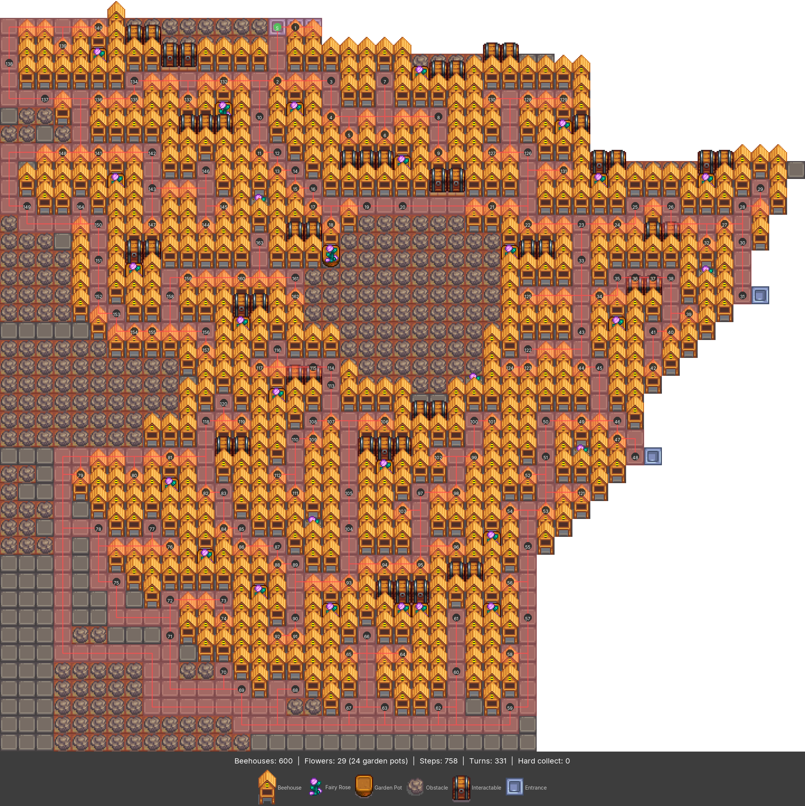

# Opti-Harvest

Opti-Harvest uses CP-SAT to arrange bee houses and flowers in Stardew Valley for the largest possible flower honey harvest, then verifies that you can reach every house to collect it.

## 600 bee houses on Ginger Island West

Our layout produces **29 more jars per harvest with 17 fewer garden pots** than Bryan Low’s controller-friendly build. Both shield the roses around the west-bank pond and leave the main crop field free. [Published layout](https://blow.sg/blog/stardew-beehouse-layout)

| Layout | Bee houses | Fairy Roses | Garden pots | Harvest steps (same route planner) |
|---|---:|---:|---:|---:|
| Bryan Low | 571 | 46 | 41 | 746 |
| Opti-Harvest | **600** | 29 | 24 | 758 |

| Build map | Harvest route |
|:---:|:---:|
| [](examples/ginger-island/600-houses.png) | [](examples/ginger-island/600-houses-route.png) |

Start at the green **S** and follow the red path through 164 numbered stops. Diagonal pickup is required at 154 houses. [Build guide](examples/ginger-island/README.md) · [Turn-by-turn walk](examples/ginger-island/harvest-walk.txt)

Game art by ConcernedApe. [Renderer by Bryan Low](https://github.com/keyute/stardew-beehouse-layout/tree/35060e2bc9881b3fccb4aad528461baeb7f5ef64).

## Open-field layouts

How many Stardew Valley bee houses fit on a plot if **every house produces flower honey and you can walk up and collect every jar**? On an open field, **49 is the exact maximum around one flower**. On the same 11×11 footprint, allowing more flowers raises the maximum to **94**. Both counts assume you can collect diagonally and walk on soil-grown flowers. The 49 matches a player's in-game experiment. [Original single-flower layout](https://www.reddit.com/r/StardewValley/comments/pqhkqo/)

[](examples/layouts.png)

## How the grid size changes the answer

Each entry is a **proven maximum**. In the open-perimeter column you can walk on a clear ring just outside the rectangle and collect from there. That ring is extra space. In the single-entrance column all collection happens inside the stated footprint, including the entrance tile at the middle of the west edge, rounded down in zero-based coordinates. The flowers in both columns grow in walkable soil.

| Plot | Open perimeter | Single entrance |
|---|---:|---:|
| 5×5 | 22 | 17 |
| 8×8 | 52 | 43 |
| 11×11 | 94 | 81 |
| 15×14 | 158 | 141 |
| 30×30 | 638 | 601 |

On an open 8×8, the proven maxima with budgets of **one, two and three flowers** are **42, 51 and 52 houses**. Three is therefore the minimum flower count for the 52-house layout. Requiring side-only collection reduces the unrestricted 8×8 maximum to 50. Making flower tiles impassable also gives 50 when diagonal collection is allowed.

The one-flower benchmark uses an 11×11 square centered on the bloom. This contains the whole radius-five diamond. Enlarging the field cannot help because every additional tile lies outside flower range and the surrounding ground is already accessible. The exact maximum is **49** with diagonal collection and a walkable bloom, **48** with diagonal collection and an impassable bloom, and **44** with side-only collection and a walkable bloom. An impassable flower still permits collection from a tile next to it. Full shielding against accidental flower picking would be a stronger rule. [Another player's shielded-flower experiment](https://blow.sg/blog/stardew-beehouse-layout)

[All 22 verified layouts, with their rules, grids and solver bounds](examples/layouts.json)

## Why there is an exact formula for open rectangles

For an obstacle-free rectangle of width $W\ge3$ and height $H\ge3$, with a walkable exterior ring, diagonal collection and unrestricted soil-grown flowers, the maximum is

$$
WH-\left\lceil\frac{(W-2)(H-2)}{3}\right\rceil.
$$

**Upper bound.** The exterior ring already lets you collect the outermost row and column on every side. Consider the $(W-2)(H-2)$ interior tiles. Grow the reachable walking area one tile at a time, always taking a cardinal step from a reachable tile. The new tile's 3×3 collection neighborhood overlaps its predecessor's in six places. Each new walking tile can therefore cover at most three previously uncovered interior tiles. Any interior tile left uncovered must itself be a non-house tile and can account for only itself. So at least one non-house tile is needed per three interior tiles, rounding up.

**Construction.** Split the interior into bands three columns wide. For each full band, run a straight path down the middle from the north boundary, stopping one tile before the last interior row. This covers the whole band for exactly one path tile per three interior tiles. Cover the remaining one or two columns with short paths entering from the east, one per group of up to three rows. Try the transposed construction too.

To see that rounding is exact, let $m=W-2=3a+r$ and $n=H-2$. The paths use $an+r\lceil n/3\rceil$ tiles. This equals $\lceil mn/3\rceil$ except when $r=2$ and $n$ leaves remainder 1 modulo 3. Swapping rows and columns resolves that case. Every interior tile is then within one diagonal collection step of an in-plot path. Even a corner lies within four Manhattan steps of a path tile, so planting flowers on enough path tiles covers every house. As both dimensions grow, the maximum fraction of the plot devoted to houses approaches **two thirds**.

## Run the solver

Tested with Python 3.12 and Google OR-Tools 9.15.

```sh
python3.12 -m venv .venv
source .venv/bin/activate
python -m pip install -r requirements.txt

python apiary.py 8 8
python apiary.py 8 8 --max-flowers 2
python apiary.py 11 11 --center-only
python apiary.py 11 11 --center-only --solid-flowers
python apiary.py 15 14 --entrance 0 7
python apiary.py 11 11 --center-only --collection 4 --seconds 90 --json
python -m unittest -v
```

The grid uses `H` for a bee house, `F` for a flower and `.` for open ground. Coordinates start at the upper left and run right and down. `--max-flowers` lets the solver choose locations within a budget. `--center-only` fixes exactly one bloom at `(width//2, height//2)`. The objective is the number of collectible houses at a single harvest. The displayed flower count describes that layout. A flower-budget sweep, as above, can also prove the minimum number of blooms needed. Irrigation, scarecrows, route length and planting costs are separate design choices.

## Model and verification

- Each tile can hold one house or one flower or stay empty. A house requires a mature, eligible flower within Manhattan distance five. A bloom can serve many houses. [Stardew Valley Wiki, Bee House](https://stardewvalleywiki.com/Bee_House)
- Movement uses the four cardinal steps. By default the farmer can stand on a soil-grown flower and collect from any of the eight neighboring tiles. Use `--collection 4` for side-only collection and `--solid-flowers` for a layout that leaves flower tiles out of walking routes. Collection reach can make a large difference to a published layout. [Player's 110-house diagonal and 99-house side-only variants](https://www.reddit.com/r/StardewValley/comments/c39f09/)
- CP-SAT chooses Boolean house, flower and route variables. Every house needs a reachable collection neighbor or direct collection from outside. Every selected route tile away from an entrance needs a cardinal route neighbor with strictly smaller integer depth. Following those neighbors must lead back to an entrance. This rules out using a sealed pocket as a collection point.
- Constructed layouts give the solver a starting count. At the time limit the program returns a verified layout, an upper bound and an optimality flag. A matching count and bound proves the house maximum. A gap gives the range still possible. `--seconds` controls solver time and `--workers` controls parallel search.
- A separate flood-fill checks the returned grid from the actual entry tiles and checks flower distance for every house. The tests compare the optimizer with exhaustive three-state enumeration on tiny grids, reject an enclosed collection pocket and check the open-rectangle construction across 100 sizes. The use of independent enumeration follows Optifarm's approach. [Serranegra/optifarm](https://github.com/Serranegra/optifarm)
