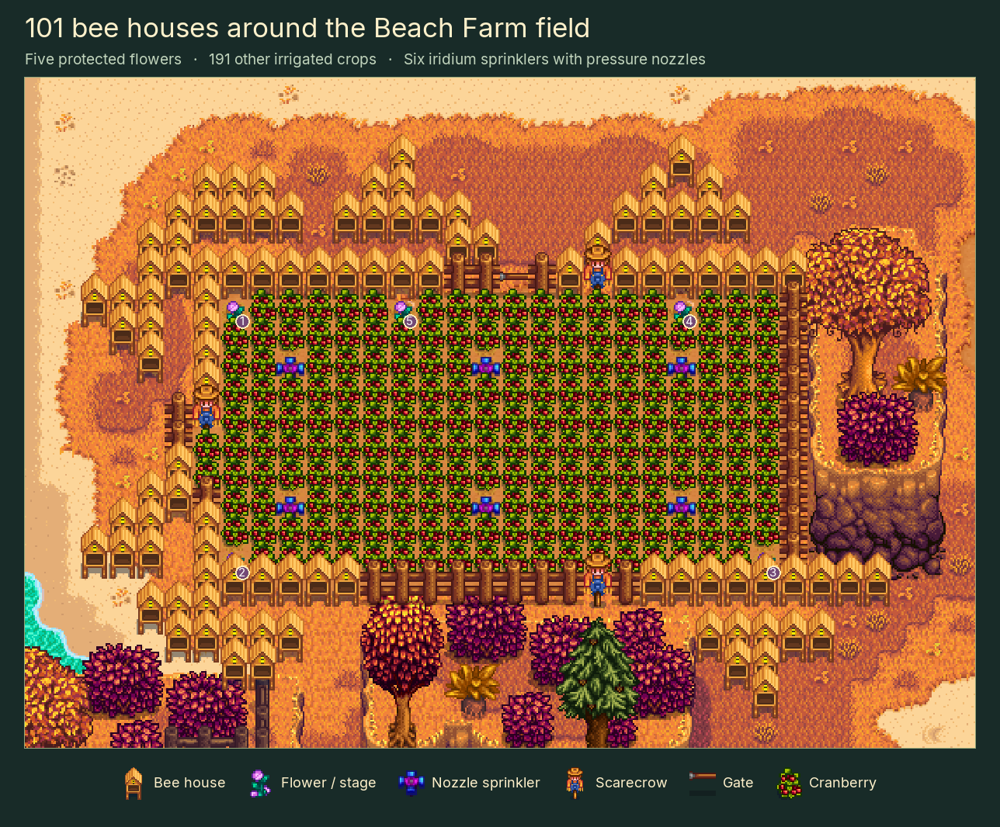
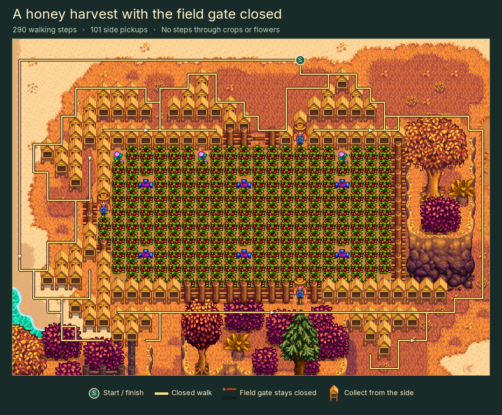

# A hundred bee houses around the Beach Farm sprinkler field

**Five flowers supply 101 bee houses while leaving 191 other crops under sprinklers.** Every house stands outside the Beach Farm’s 202-tile dirt patch. Collect every jar from the side with the field gate closed. Open the gate to harvest the crops or replant seasonal flowers without moving a house. A full fall harvest with Artisan sells for **96,152g in honey alone**. [Beach Farm terrain](https://stardewvalleywiki.com/Farm_Maps) · [Honey prices and seasons](https://stardewvalleywiki.com/Honey)

| Five-flower build | 290-step honey walk |
|:---:|:---:|
| [](build-map.png) | [](harvest-route.png) |

## Start with one flower

The first rose goes in the northwest corner of the dirt field. The second goes in its southwest corner. Together they supply 54 houses. Each stage keeps **every earlier house and flower**. When adding houses to the perimeter, replace the corresponding fence sections.

| Flowers planted | Bee houses | Other irrigated crop tiles |
|---:|---:|---:|
| [1 · tile plan](stage-1.txt) | 28 | 195 |
| [2 · tile plan](stage-2.txt) | 54 | 194 |
| [3 · tile plan](stage-3.txt) | 71 | 193 |
| [4 · tile plan](stage-4.txt) | 88 | 192 |
| [**5 · tile plan**](stage-5.txt) | **101** | **191** |
| 8 | 125 | 188 |
| [16 · tile plan](build.txt) | 145 | 180 |

These counts use six pressure-nozzle iridium sprinklers. **The same 101-house layout and walk also work with eight ordinary iridium sprinklers and one basic sprinkler**, leaving 188 other irrigated crops. Both versions use three ordinary scarecrows and zero garden pots. Relative to the six-nozzle crop-only field, each rose replaces exactly one crop. [Sprinkler ranges](https://stardewvalleywiki.com/Iridium_Sprinkler) · [Scarecrow range](https://stardewvalleywiki.com/Scarecrow)

## Building it

- Clear the western dirt patch, including its large logs. Stand above the field and face south. The main dirt rectangle is 20 tiles wide and 10 deep, with two extra dirt tiles on its west side. In the planner’s zero-based map coordinates, the rectangle begins at **(25, 50)**. The upper-left tile of every stage plan is map coordinate (16, 41). [Five-flower plan](stage-5.txt) · [Beach Farm](https://stardewvalleywiki.com/Farm_Maps)
- Place the six upgraded sprinklers at columns **27, 34 and 41** on rows **52 and 57**. For the ordinary version use columns **27, 32, 37 and 42** on both rows and place one basic sprinkler on the lower extra dirt tile at **(24, 56)**. The upper extra tile receives water from it.
- Put the gate at **(35, 49)**, between two fence posts, directly north of the field. Place scarecrows at **(24, 54), (38, 49) and (38, 60)**. Complete the marked perimeter with houses and fences. Closing the gate keeps every outside standing tile at least two tiles from every flower, including diagonally. Open it to reach all the plants. Use walkable crops such as the cranberries shown. [Gate mechanics](https://stardewvalleywiki.com/Gate)
- For the five-flower build, plant at **(25, 50), (25, 59), (44, 59), (41, 50) and (31, 50)** in that order. Water new seeds as needed on planting day. In the grid, `H` is a house, `F` a flower, `C` a regular crop, `@` an upgraded sprinkler, `K` a scarecrow, `I` a fence and `G` the gate. The full [planting order](planting-order.txt) covers all 16 stages.
- For the 101-house harvest, start at **(38, 43)** and follow the [saved round trip](harvest-walk.txt). Its 290 steps count movement between tiles. Turning and collecting take additional time.

## What is optimal

With the pictured six-sprinkler field, wall, scarecrows and gate fixed, **28, 54, 71, 88 and 101 are the exact maxima for one through five flowers.** Five is the minimum needed to reach 100, and the same build attains all five maxima in order. These results allow all legal flower positions in the field and side-only pickup from any reachable exterior tile on the mapped ground. Moving the gate or permitting diagonal pickups changes the optimization problem.

The proof removes planting sites when another site covers every house they could cover. It then bounds groups of the remaining sites. Any feasible set of houses can be assigned to the flowers that serve it. Removing the houses assigned to other flowers keeps the remaining pickups reachable. The sum of the subgroup maxima therefore bounds the full layout. CP-SAT checks the cases left open by those sums. The printed plans supply the matching lower bounds. [Executable proof](prove.py)

Six pressure-nozzle sprinklers also achieve the minimum number needed to cover this entire field with sprinklers alone. Each covers at most seven of the 20 tiles on the top edge. The bottom edge needs another three because the edges are nine rows apart.

The field and its border were checked against Henrik Peinar’s legacy and current Beach Farm planner layers. The [terrain file](terrain.txt) uses only squares marked both buildable and accessible in both editions. An independent flood-fill checks flower shielding, crop access with the gate open and every step of the honey walk with it closed. The higher stages are buildable counts in that model. An in-game playtest remains open. [Legacy planner data](https://github.com/hpeinar/stardewplanner/tree/f6c8dd5fba513d78b95d491a8aa77d6532c55ee6/public/planner/js/data/layer-information) · [Current buildable layer](https://stardew.info/planner/assets/dataLayers/beach_buildable.json) · [Current accessible layer](https://stardew.info/planner/assets/dataLayers/beach_accessible.json)

From the repository root, replay the pictured five-flower build or print an intermediate stage from the full 16-flower plan.

```sh
d=examples/beach-farm
python beach_farm.py "$d/terrain.txt" "$d/stage-5.txt" --walk "$d/harvest-walk.txt"
python beach_farm.py "$d/terrain.txt" "$d/build.txt" --stage 8 --print-grid
python beach_farm.py "$d/terrain.txt" "$d/build.txt" --stage 5 --standard --walk "$d/harvest-walk.txt"
python "$d/prove.py"
# Search again with a different flower budget.
python beach_farm.py "$d/terrain.txt" /tmp/beach-six.txt --flowers 6 --seconds 60
```

Game artwork by ConcernedApe. The fall map and object sprites come from Henrik Peinar’s Stardew Valley Planner. The mature rose sprite comes from Bryan Low’s renderer. [Planner](https://stardew.info/planner/) · [Fall map](https://stardew.info/planner/assets/farms/farm_island_fall.png) · [Sprite atlas](https://stardew.info/planner/assets/tilesheets/sprites.png) · [Rose sprite](https://github.com/keyute/stardew-beehouse-layout/blob/35060e2bc9881b3fccb4aad528461baeb7f5ef64/assets/fairy_rose.png)
