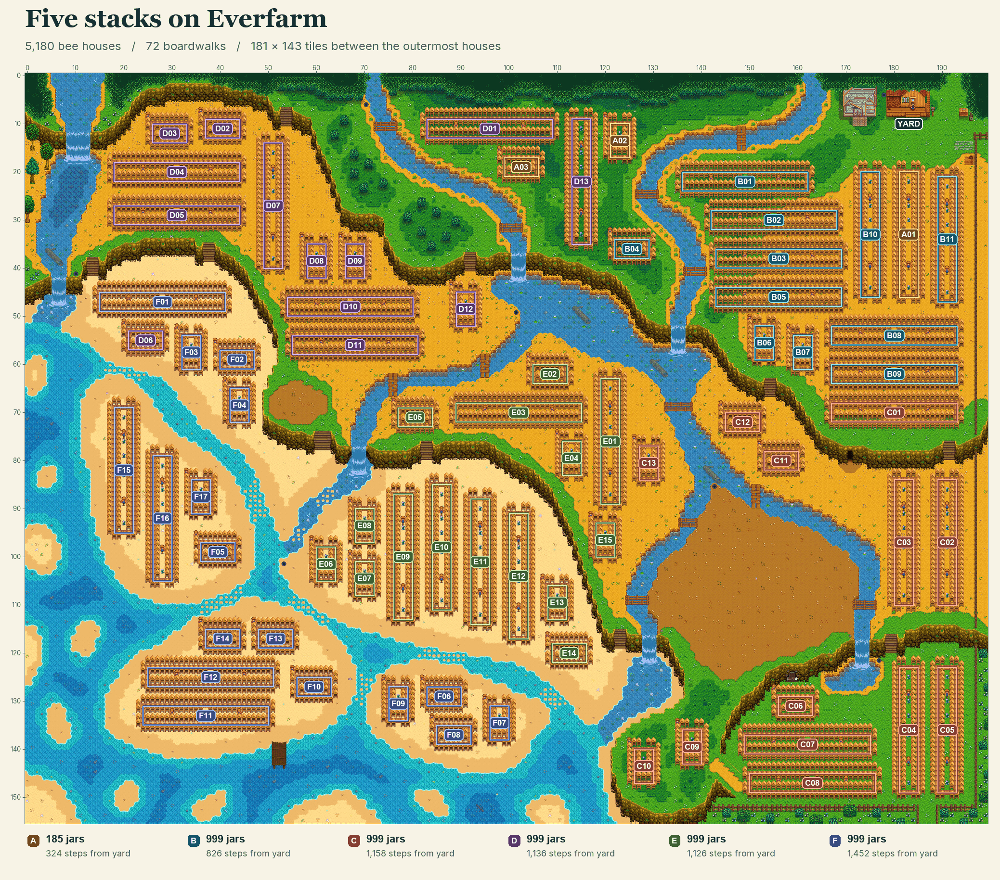
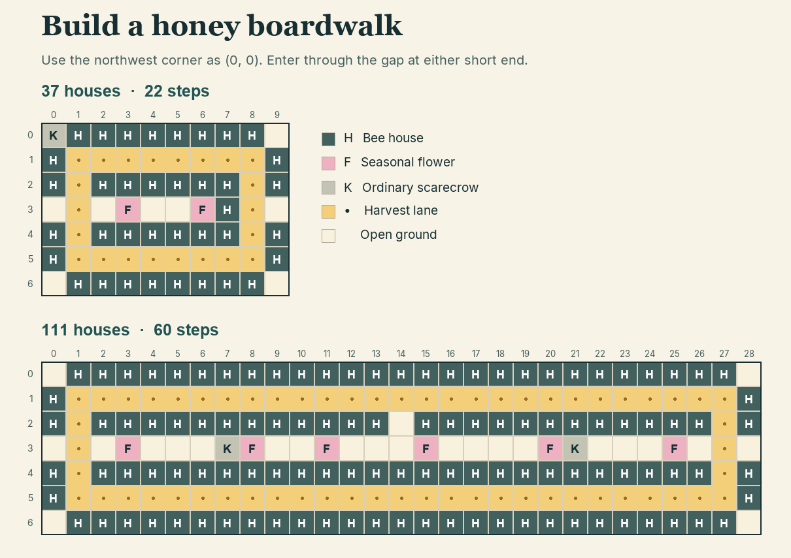
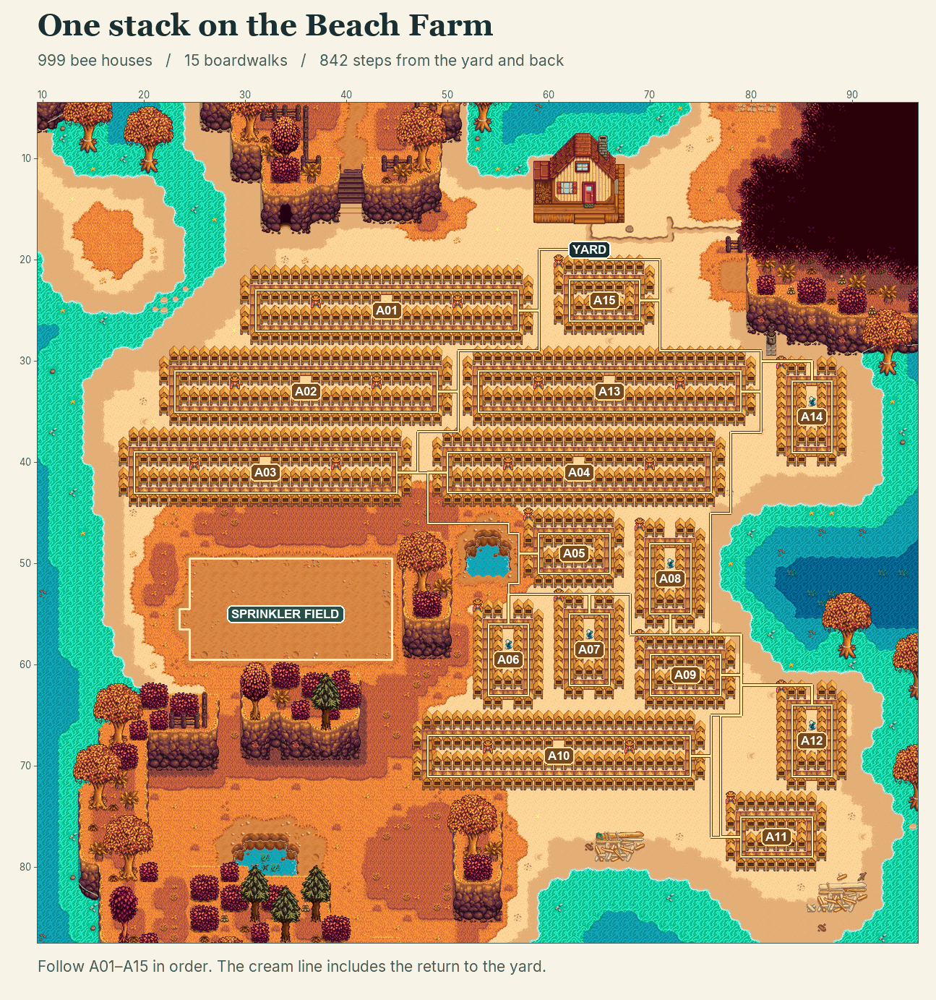

# Five stacks of honey on Everfarm

**5,180 bee houses fit on one Everfarm map.** Five collection routes each bring home a full stack of 999 jars. A sixth brings home another 185. With mature Fairy Roses and Artisan, the six loads sell for **4,931,360g** at the standard profit margin. The same two boardwalks fit **999 houses on the vanilla Beach Farm**, with its entire 202-tile sprinkler field free. [Everfarm by Draylon](https://www.nexusmods.com/stardewvalley/mods/9347) · [Honey prices](https://stardewvalleywiki.com/Honey) · [Stack size](https://stardewvalleywiki.com/Chest)

[](everfarm-map.png)

## How much bigger?

The house footprint is the smallest rectangle containing **actual bee houses**, inclusive of both endpoints. The working-tile count includes houses, plants, equipment and distinct collection-lap tiles. It excludes travel between laps. It measures the ground a player actually uses on farms divided by water. [Four Corners comparison](../four-corners/README.md#how-much-larger-is-it)

| Farm | Houses | House footprint | Area inside footprint | Working tiles |
|---|---:|---:|---:|---:|
| Four Corners co-op · vanilla | 1,200 | 74 × 57 | 4,218 | 2,339 |
| Beach boardwalks · vanilla | 999 | 72 × 60 | 4,320 | 1,632 |
| Everfarm boardwalks · modded | **5,180** | **181 × 143** | **25,883** | **8,442** |

The Everfarm houses extend from **(14, 8) to (194, 150)** by coordinate extrema. The footprint covers **6.14 times** the Four Corners area. Even counting only working tiles gives **3.61 times** as much ground in use. On the smaller Beach build the footprint gains 2.4% over Four Corners, with 201 fewer jars and a full sprinkler field available for another use. [Everfarm coordinates](everfarm-sites.txt) · [Beach coordinates](beach-sites.txt)

## Build the first boardwalk

[](planting-chart.png)

**Try the short boardwalk just below the Beach farmhouse.** Its northwest corner is **(61, 21)**, marked **A15**. Put an ordinary scarecrow there and plant the first flower at **(64, 24)**. The 27 marked house sites within five Manhattan tiles of that flower can operate immediately once it blooms. Plant at **(67, 24)** to add the remaining ten. All 37 houses and both flowers are in their final positions. The first 37 houses cost 1,480 wood, 296 coal, 37 iron bars and 37 maple syrup if you craft them all. [Short tile plan](short-boardwalk.txt) · [Bee house recipe and range](https://stardewvalleywiki.com/Bee_House)

| Copy this patch | Bee houses | Soil flowers | Ordinary scarecrows | One closed lap |
|---|---:|---:|---:|---:|
| 10 × 7 | 37 | 2 | 1 | **22 steps** |
| 29 × 7 | 111 | 6 | 2 | **60 steps** |

- Clear the footprint and keep the lane and the two end entrances open. Flooring is optional. All coordinates start at zero in the northwest. At an **H** site the chart runs left to right. At a **V** site the chart’s columns run **south** and its rows run **east**. For example, local (3, 3) at a site starting at (180, 19) lands on (183, 22).
- Plant one kind of seasonal flower on the pink squares. For a fall build, use Fairy Seeds. Water until they bloom, or apply Deluxe Retaining Soil and water once. Leave the mature flowers planted. The plans use ordinary soil, including tillable sand, and require zero pots or sprinklers. The short planting row opens at one end. The long row has an opening beyond each scarecrow and a third opening in the middle so every section can be replanted. [Deluxe Retaining Soil](https://stardewvalleywiki.com/Deluxe_Retaining_Soil) · [Scarecrow range](https://stardewvalleywiki.com/Scarecrow)
- Enter from either short end and walk the gold rectangle once, collecting jars from the side. Every standing tile on the lap and the saved approaches is at least two tiles from a flower, even diagonally. Three short boardwalks give the yield of one long boardwalk for six extra lap steps. [Long tile plan](boardwalk.txt)

**Both lap lengths are optimal for hand collection on these fixed house layouts.** The long build has houses at both extremes of its 29 columns. Side pickup requires visiting a column at most 1 and a column at least 27. The top and bottom houses likewise force a visit to row 1 or above and row 5 or below. Returning to the start costs at least twice the horizontal span plus twice the vertical span, or **2 × (26 + 4) = 60**. On the short build the same argument gives **2 × (7 + 4) = 22**. Walking outside the patch cannot shorten either bound.

## A full stack on the vanilla Beach Farm

[](beach-map.png)

Six long and nine short boardwalks give **999 jars** from 54 flowers and 21 ordinary scarecrows. The cream line leaves the farmhouse yard at **(64, 19)**, passes A01 through A15 and returns in **842 steps**. Both the equipment and the walk stay clear of the sprinkler field. A full fall stack sells for **951,048g with Artisan**. [Placement coordinates](beach-sites.txt) · [Full 842-step walk](beach-walks.txt) · [Beach Farm soil](https://stardewvalleywiki.com/Farm_Maps)

For a solo harvest, first collect the four groups on successive days. Then return to each group four days after its last pickup. Ready honey can wait while you set up the rotation or wait for flowers to bloom. Each row below is a separate, checked trip from the farmhouse yard and back. Bee houses produce every four nights during spring, summer and fall on the home farm. [Four daily walks](beach-daily.txt) · [Honey timing](https://stardewvalleywiki.com/Bee_House)

| Day | Boardwalks | Jars | Steps including travel home |
|---|---|---:|---:|
| 1 | A01–A02 | 222 | 182 |
| 2 | A03–A05 | 259 | 266 |
| 3 | A06–A10 | 259 | 348 |
| 4 | A11–A15 | 259 | 362 |

A vanilla Beach Farm save can also run the existing soil-only Ginger Island apiary. Together the two maps support **2,050 jars with zero pots**, worth **1,951,600g** when both have mature Fairy Roses in fall. In winter the 1,051 island houses continue producing. The island has its own checked 1,448-step walk and 137 irrigated pineapple tiles. [Ginger Island build and walk](../soil-only-million/README.md) · [Island honey production](https://stardewvalleywiki.com/Bee_House)

## Five full stacks and a 185-jar run on Everfarm

Use Draylon’s **Everfarm** layout for this build. The 34 long and 38 short boardwalks take **280 flowers and 106 ordinary scarecrows**. Building all 5,180 houses from scratch costs 207,200 wood, 41,440 coal, 5,180 iron bars and 5,180 maple syrup. Each numbered patch works on its own, so a player can stop expanding at any boardwalk. The first long one south of the farmhouse is **A01**, with its northwest corner at **(180, 19)**. [Everfarm mod](https://www.nexusmods.com/stardewvalley/mods/9347) · [Placement coordinates](everfarm-sites.txt)

| Route from the yard at (183, 10) | Short boardwalks | Long boardwalks | Jars | On the laps | Total steps including travel home |
|---|---:|---:|---:|---:|---:|
| A | 2 | 1 | 185 | 104 | 324 |
| B | 3 | 8 | 999 | 546 | 826 |
| C | 6 | 7 | 999 | 552 | 1,158 |
| D | 6 | 7 | 999 | 552 | 1,136 |
| E | 9 | 6 | 999 | 558 | 1,126 |
| F | 12 | 5 | 999 | 564 | 1,452 |

Follow one letter in numerical order. Each line of the directions starts where the previous one ended. For example, `N4` means four tiles north. Each named leg finishes after the complete lap at its destination. The final line takes you back to the yard. The saved walks use ordinary foot travel across mapped bridges, stairs and stepping stones. The numbers count movement only. Turning, aiming and picking 999 individual jars add time, and a route can be split across visits. [All six walks](everfarm-walks.txt)

## Search, terrain and verification

CP-SAT first minimizes the number of protected interior flowers supplying the houses on each chart, with its scarecrows and lanes fixed. Two and six are the respective minima. For the farm search, we enumerate both orientations of both boards on clear buildable ground. Every flower must have tillable soil. Each candidate has a one-tile walking rim. Greedy sweeps propose placements, then CP-SAT selects compatible candidates that maximize the jar count. Neighboring boards may share a walking rim. Packing is optimized within the sampled candidates, so the saved yields are feasible lower bounds on whole-farm capacity.

The checker independently transforms the tile charts, checks overlap, flower range, native soil and scarecrow coverage, and flood-fills the finished build to check replanting access. It replays every step from the yard, checks for flower-safe travel, and verifies each boardwalk’s distinct loop tiles and every side pickup. The two single-board lap lengths have matching lower bounds. The multi-board route lengths are measured feasible walks. Terrain and collection time still await an in-game playtest, particularly if your Everfarm version differs from the planner snapshot.

Run the checks and searches from the repository root with the project dependencies installed.

```sh
d=examples/boardwalk-apiary
python "$d/plan.py" everfarm
python "$d/plan.py" beach
python "$d/plan.py" beach --daily
python "$d/plan.py" beach --grid
python "$d/search.py" flowers
python "$d/search.py" everfarm
```

The two saved terrain files let the checks and searches run offline. `P` is tillable and buildable, `.` is other buildable ground, `W` is travel only, `E` is the yard and `X` is excluded. The Everfarm survey adds only the marked crossing centerlines to walkable buildable ground. It reserves the yard and a clearing around each warp for travel. The Beach survey intersects the legacy and current planner layers and excludes the sprinkler field from travel. To regenerate a survey from its online sources, run `python examples/boardwalk-apiary/survey.py everfarm` or substitute `beach`. [Terrain importer](survey.py) · [Pinned planner layers](https://github.com/hpeinar/stardewplanner/tree/f6c8dd5fba513d78b95d491a8aa77d6532c55ee6/public/planner/js/data/layer-information) · [Beach access](https://stardew.info/planner/assets/dataLayers/beach_accessible.json) · [Beach buildability](https://stardew.info/planner/assets/dataLayers/beach_buildable.json) · [Beach soil](https://stardew.info/planner/assets/dataLayers/beach_tillable.json)

Stardew Valley artwork by ConcernedApe. Everfarm by Draylon. Map images and object sprites via Henrik Peinar’s Stardew Valley Planner. Flower and floor sprites via Bryan Low. [Everfarm map](https://github.com/hpeinar/stardewplanner/blob/f6c8dd5fba513d78b95d491a8aa77d6532c55ee6/public/planner/img/layouts/everfarm.jpg) · [Beach autumn map](https://stardew.info/planner/assets/farms/farm_island_fall.png) · [Object sprites](https://stardew.info/planner/assets/tilesheets/sprites.png) · [Flower and floor art](https://github.com/keyute/stardew-beehouse-layout/tree/35060e2bc9881b3fccb4aad528461baeb7f5ef64/assets)
