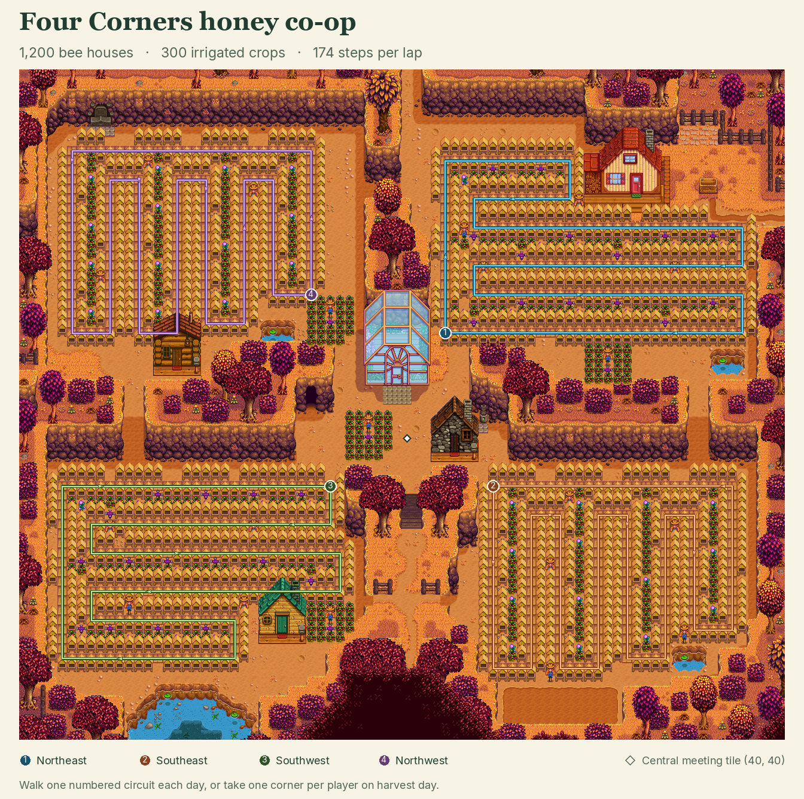
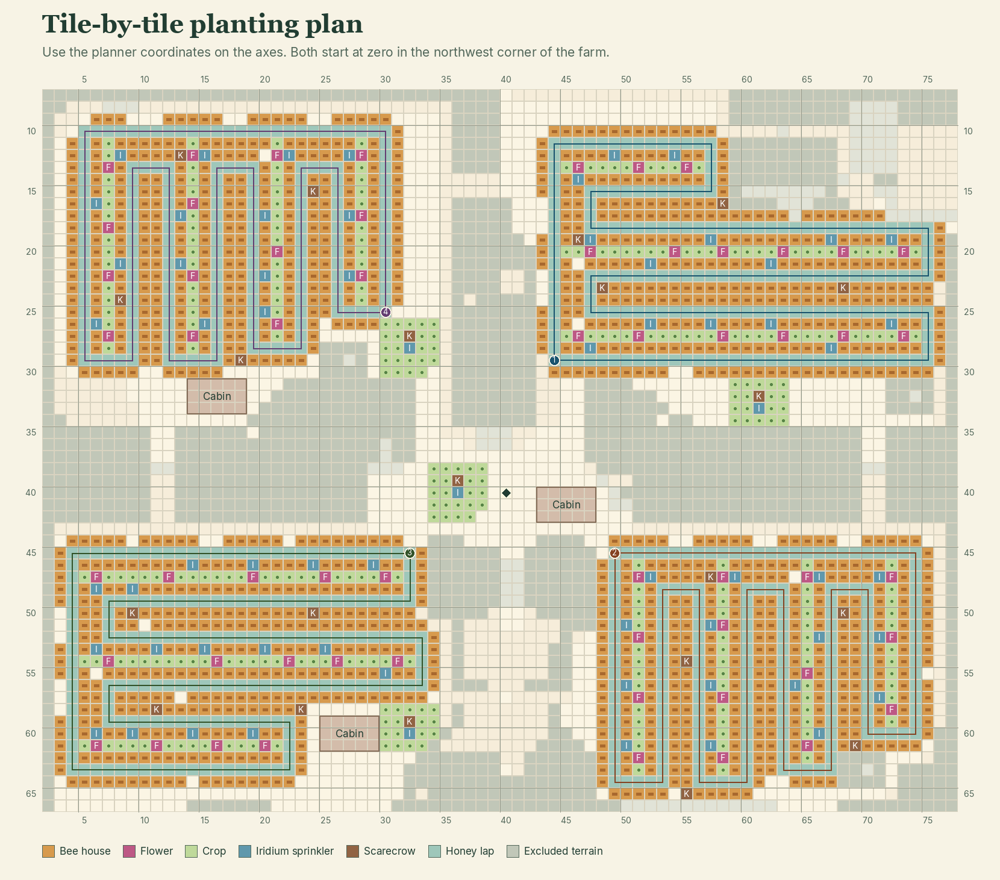

# Four Corners honey co-op

**Four players can each take a 174-step lap and come home with 300 jars.** A solo farmer can collect one corner a day on a four-day rotation. Each grower also gets 75 irrigated crop tiles. Three farmhand cabins fit alongside the original farmhouse.

[](build-map.png)

## How much larger is it?

The bee houses themselves span **74×57 tiles**, from (3, 9) to (76, 65) inclusive. The earlier 1,051-house, 40-pot Ginger Island build spans **83×44**. That takes the honey footprint from 3,652 to **4,218 square tiles**, a **15.5% larger bounding box**. Both boxes include terrain between their outermost houses. The complete source maps measure 80×80 and 84×45 respectively. [Earlier island build](../soil-only-million/fewer-pots/farm.txt) · [Island terrain](../mixed-farm/terrain.txt)

A second measure counts only distinct tiles actually used for production or honey collection. Count each house, plant, sprinkler, scarecrow and tile stepped on during the saved harvest once. Four Corners uses **2,339** such tiles before counting cabins or travel to the loops. The 40-pot island plan uses **2,323** under the same rule. [Four Corners tile grid](farm.txt) · [Island harvest walk](../soil-only-million/fewer-pots/harvest-walk.txt)

## Build and run a corner

[](planting-plan.png)

1. Use the numbered map to orient yourself and the **planting chart** to place individual objects. The coordinates are zero-based, with (0, 0) in the northwest corner of the full farm. Clear debris and open the passages you intend to use. Leave the marked honey lanes open. Flooring is optional.
2. Plant one kind of seasonal flower on the pink **F** tiles. Water the seeds on planting day and leave the blooms standing. Fill the green crop tiles with a **walk-through crop**, such as cranberries in fall. The beds inside the loops have an open end for replanting. The southeast grower's extra square is beside the cabin in the central clearing. All 300 crop tiles and all 57 flowers receive ordinary iridium sprinkler water and scarecrow coverage. [Iridium sprinkler](https://stardewvalleywiki.com/Iridium_Sprinkler) · [Scarecrow](https://stardewvalleywiki.com/Scarecrow)
3. For co-op, the upper-left corners of the 5×3 cabin sites are (14, 31), (25, 59) and (43, 40). The checker treats all three footprints as solid and keeps every tile across each south frontage accessible. On a solo farm you can leave those pads empty. [Cabin dimensions](https://stardewvalleywiki.com/Cabin)
4. Start at the numbered tile, collect from either side as you walk, and finish on the same tile. Every jar has a cardinal pickup. No honey lane passes within picking distance of a flower, including diagonally. The [turn-by-turn walks](walks.txt) use `N18` for 18 tiles north. The last column below adds the walk out from (40, 40) in the central clearing and back. Turning and interacting with machines take additional game time.

| Corner | Lap start | Flowers | Iridium sprinklers | Ordinary scarecrows | Steps from clearing, around lap and back |
|---|---|---:|---:|---:|---:|
| 1 · NE | (44, 29) | 15 | 16 | 5 | 204 |
| 2 · SE | (49, 45) | 14 | 16 | 6 | 202 |
| 3 · SW | (32, 45) | 14 | 17 | 5 | 200 |
| 4 · NW | (30, 25) | 14 | 16 | 5 | 224 |

**A smaller start fits the same plan.** In the southwest, plant (16, 54), then (7, 54), then (12, 47). At each stage build only the marked southwest houses within five Manhattan tiles of a planted flower. That gives **32 → 62 → 91 houses**, with every earlier house and flower staying in its final position. A complete corner takes 12,000 wood, 2,400 coal, 300 iron bars and 300 maple syrup if you craft all 300 houses. [Bee house recipe and flower range](https://stardewvalleywiki.com/Bee_House)

## Harvest calendar

For a solo rotation, let all four corners become ready and first collect them on four successive days. Return to the first corner on day five. For a co-op harvest, synchronize the houses and give each player a corner. Each route visits 174 distinct tiles before closing. The beds can be tended separately without lifting any equipment.

| Mature bloom | Artisan price per jar | One corner · 300 jars | Four corners · 1,200 jars |
|---|---:|---:|---:|
| Spring · Blue Jazz | 280g | 84,000g | 336,000g |
| Summer · Poppy | 532g | 159,600g | 638,400g |
| Fall · Fairy Rose | 952g | **285,600g** | **1,142,400g** |

These are gross honey sales at the standard profit margin. Flower type is determined at pickup, so ready honey can wait for a flower to bloom. A Fairy Rose normally takes 12 days to mature. The main farm produces honey in spring, summer and fall. The island builds also produce in winter. [Honey prices and growing times](https://stardewvalleywiki.com/Honey) · [Bee house timing](https://stardewvalleywiki.com/Bee_House)

## Search and verification

We tried folded walking lanes against the Four Corners terrain, shortening the arms near the farmhouse and ponds. For each selected loop, CP-SAT chooses 300 houses on adjacent tiles, flower positions on the inner planting rows, and sprinklers and scarecrows. Each house needs a local mature flower within five Manhattan steps. Each planting row keeps an open end. Four additional sprinkler plots bring each grower's crop allotment to 75. The search favors fewer sprinklers and more inner-row space for crops. These are feasible layouts. The best yield or shortest walk over the whole map remains open.

The earlier closed-walk bound gives a comparison independent of this terrain. An accessible side-pickup lap of length $L$ can serve at most $2L-5$ houses. At 300 jars the lap must be at least **154 steps**, since any closed cardinal walk has even length. The four published laps are each within **20 steps** of this lower bound. [Counting proof](../repeating-apiary/proof.md)

The [checker](plan.py) reads the saved grid and directions independently of the placement model. It replays every step, checks the distinct pickup sets, irrigation, crow protection, flower safety and walking access to every plant. It also finds crop-free, flower-safe paths from the clearing to all four lap starts, cabin fronts and marked farm landmarks. The terrain is the intersection of the legacy and current planner layers for accessible, buildable and tillable tiles. Placement and collection time still await an in-game playtest. [Legacy planner layers](https://github.com/hpeinar/stardewplanner/tree/f6c8dd5fba513d78b95d491a8aa77d6532c55ee6/public/planner/js/data/layer-information) · [Current access layer](https://stardew.info/planner/assets/dataLayers/fourcorners_accessible.json) · [Build layer](https://stardew.info/planner/assets/dataLayers/fourcorners_buildable.json) · [Soil layer](https://stardew.info/planner/assets/dataLayers/fourcorners_tillable.json)

From the repository root, replay the published plan or run CP-SAT on the same four loops. A fresh search may produce a different arrangement.

```sh
python examples/four-corners/plan.py
python examples/four-corners/plan.py --solve /tmp/four-corners-farm.txt --seconds 30
```

In the [tile grid](farm.txt), `H` is a house, `F` a flower, `C` a crop, `I` an iridium sprinkler, `K` a scarecrow, `c` a cabin footprint and `+` a lap. `E` marks the central meeting tile. The [survey](terrain.txt) uses `P` for tillable soil, `.` for other buildable ground, `W` for walk-only ground and `X` for excluded terrain.

Stardew Valley artwork by ConcernedApe. Farm map and object sprites via Henrik Peinar's Stardew Valley Planner. Flower and floor sprites via Bryan Low. [Autumn farm map](https://stardew.info/planner/assets/farms/farm_fourcorners_fall.png) · [Planner sprite atlas](https://stardew.info/planner/assets/tilesheets/sprites.png) · [Flower and floor art](https://github.com/keyute/stardew-beehouse-layout/tree/35060e2bc9881b3fccb4aad528461baeb7f5ef64/assets)
