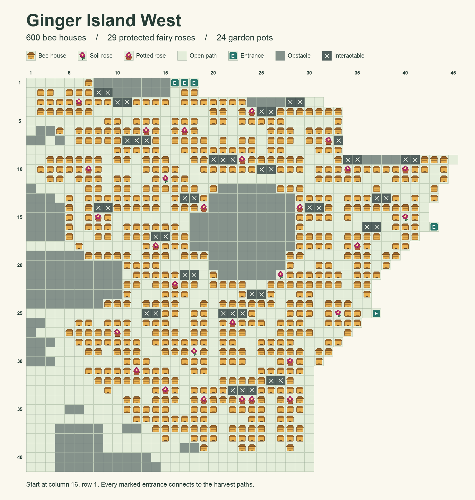

# A 600-house apiary on Ginger Island West

The west bank, on the lower-left side of Ginger Island, can supply **600 jars of Fairy Rose Honey per harvest** using **29 roses and 24 garden pots**. The main crop field across the river stays available. The plan uses Stardew Valley 1.6.6 or later, when flowers in pots contribute to honey. [Bee House version history](https://stardewvalleywiki.com/Bee_House)

[Open the full-resolution build map](build-map.png) · [Tile-by-tile plan](600-houses.txt) · [Harvest walk](harvest-walk.txt)

The game-sprite renders show the [600-house layout](600-houses.png) and the [same layout with the 758-step harvest path](600-houses-route.png). Follow the red path from the green S and collect at the 164 numbered stops in order. The sprites are Stardew Valley artwork by ConcernedApe, rendered with [Bryan Low’s layout renderer](https://github.com/keyute/stardew-beehouse-layout/tree/35060e2bc9881b3fccb4aad528461baeb7f5ef64).



## Building it

1. Find the pond on the west bank. Orient the map with the three adjacent entrances to the north and the two bridges to the east. The numbered columns and rows both start at one. The walk begins at the leftmost northern entrance, column 16, row 1. The colored tiles in the source terrain overlay can help align the plan with a save. [Bryan Low's in-game terrain overlay](https://blow.sg/blog/stardew-beehouse-layout/ginger-island-overlay-verified.png)
2. Plant the five soil roses and 24 potted roses first. Deluxe Retaining Soil and an initial watering let you close up the beds while the flowers grow. Leave the mature roses planted. [Garden pot watering](https://stardewvalleywiki.com/Garden_Pot) and [Deluxe Retaining Soil](https://stardewvalleywiki.com/Deluxe_Retaining_Soil)
3. Place the houses around the roses, working outward from the enclosed beds. Keep the light-green lanes open. Each rose has all eight neighboring tiles accounted for, with houses, other flowers or permanent obstructions shielding it on every side.
4. Walk the lanes and collect from neighboring tiles. **154 houses need a diagonal pickup.** Each of those has a reachable collection position clear of nearby interactable obstacles by the benchmark's controller rule. The saved walk starts and ends at the same entrance and takes 758 cardinal steps. For example, `S3 E2` means walk three tiles south, then two east. The step count measures movement. It excludes the time spent aiming and collecting.

At the Artisan sale price of 952g per jar, a full harvest is **571,200g**. Capital costs and the time needed to build the apiary are separate from this gross revenue. [Honey sale prices](https://stardewvalleywiki.com/Honey)

## Comparison on the same terrain

Bryan Low published a 571-house controller-friendly design and a 575-house version with 13 hard pickups. We decoded his 571-house image with his own converter and used that layout as the starting point. Both new layouts pass his `validate_solution(..., no_hard=True)` check. [Published results](https://blow.sg/blog/stardew-beehouse-layout) and [reference implementation](https://github.com/keyute/stardew-beehouse-layout/tree/35060e2bc9881b3fccb4aad528461baeb7f5ef64)

| Layout | Houses | Roses | Garden pots | Hard pickups | Flowers touching uncharted tiles |
|---|---:|---:|---:|---:|---:|
| Published controller-friendly build | 571 | 46 | 41 | 0 | 7 |
| 600-house build | 600 | 29 | 24 | 0 | 0 |
| 602-house variant | 602 | 31 | 26 | 0 | 5 |

The two extra jars in the [602-house grid](602-houses.txt) cost two extra pots. Five shielded roses in that variant rely on treating terrain beyond the map boundary as inaccessible, as in the published rules. The 600-house plan verifies every rose's shielding entirely within the survey. Its advantage over the 571-house design is 29 jars and 17 fewer pots, or **27,608g more per full Artisan harvest**.

Low’s published 742-step walk starts at the eastern bridge. From the same northern entrance, the shortest walks for his 571-house layout and the pictured 600-house layout take **744 and 756 steps**, respectively. The 758-step walk above is the one drawn on the route map. [Shortest walks and proofs](../short-harvest/README.md#why-changing-the-map-saves-walking)

The tile placements and walks have been checked computationally against the hand-transcribed map. In-game placement, NPC schedules and collection timing still need a playtest. The improvement is relative to the cited layout. Priority and global optimality remain open.

## Reproducing the checks

From the project root with the dependencies installed, verify both layouts and replay the packaged walk.

```sh
python island.py examples/ginger-island/terrain.txt examples/ginger-island/600-houses.txt --guard-edges
python island.py examples/ginger-island/terrain.txt examples/ginger-island/602-houses.txt
python island_route.py examples/ginger-island/terrain.txt examples/ginger-island/600-houses.txt --check examples/ginger-island/harvest-walk.txt
```

To continue the search from the 600-house plan, use `--output improved.txt --passes 6 --guard-edges` on the first command. CP-SAT rearranges overlapping patches while keeping surrounding placements fixed. It represents each connected region of fixed open ground as one node, so it checks paths across the whole island even when moving only a handful of houses. The two input budgets cap the total flowers and pots at the counts in the starting layout. A separate flood-fill checks every accepted change. Multiworker runs can find different improvements.

The text grids use the upstream convention. `B` is a house, `F` is a soil-grown rose, and `f` is a potted rose. Vacant tiles retain their underlying terrain symbols. `E` marks an entrance, `X` an obstruction, and `I` an interactable obstruction. All five entrance tiles must connect by cardinal movement. Every house must have a flower within Manhattan distance five and a reachable collection tile. Any cardinal pickup qualifies. A diagonal pickup qualifies when there is no interactable obstruction among the standing tile's eight neighbors.

To obtain the starting grid independently, download the [original 571-house PNG](https://blow.sg/blog/stardew-beehouse-layout/ginger-island-layout-no-hard.png). In the [reference repository](https://github.com/keyute/stardew-beehouse-layout/tree/35060e2bc9881b3fccb4aad528461baeb7f5ef64), run `uv run beehouse convert baseline.png --map maps/ginger_island_west_left_bottom.yml --output baseline.txt`. Our optimizer accepts the resulting grid including its metadata header.

Terrain transcription by Bryan Low, based on iaia_'s in-game survey. The included terrain is distributed under the original MIT license. [Source terrain](https://github.com/keyute/stardew-beehouse-layout/blob/35060e2bc9881b3fccb4aad528461baeb7f5ef64/maps/ginger_island_west_left_bottom.yml), [survey](https://www.reddit.com/r/StardewValley/comments/1k5rod1/all_plantable_areas_on_ginger_island_farm/) and [license](TERRAIN-LICENSE).
