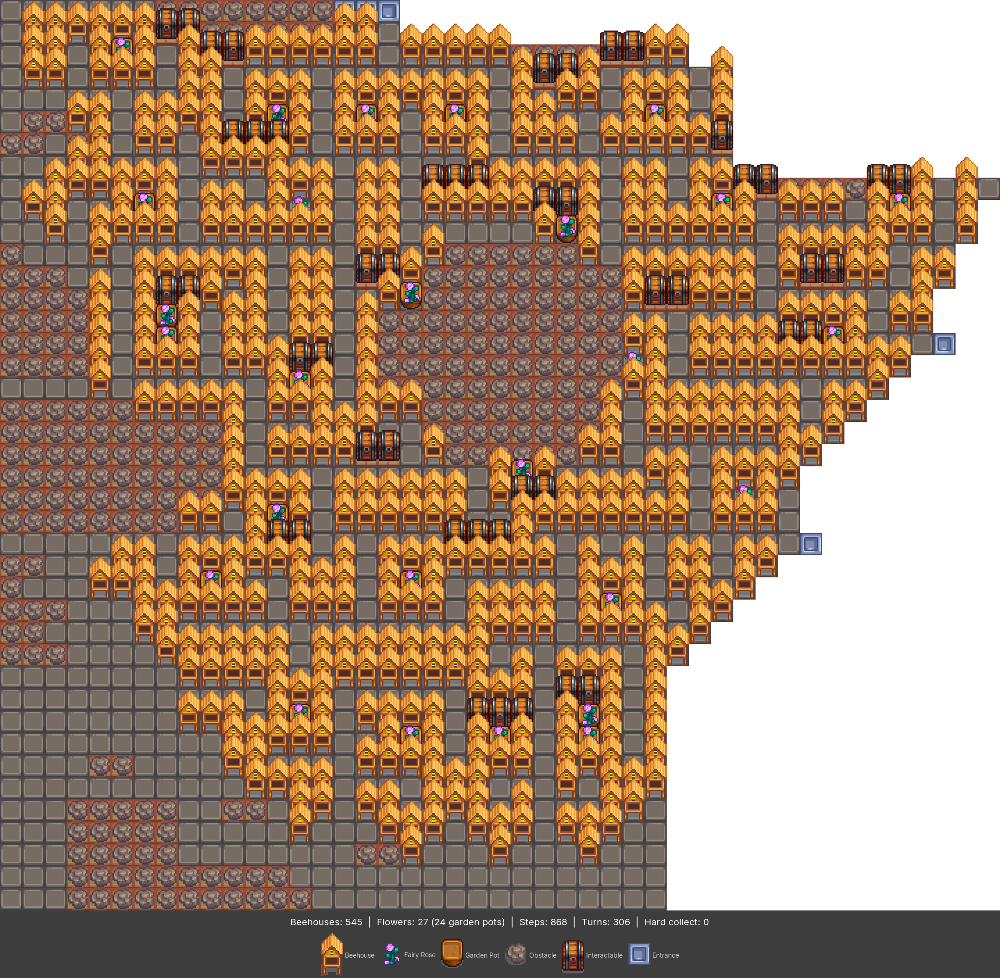
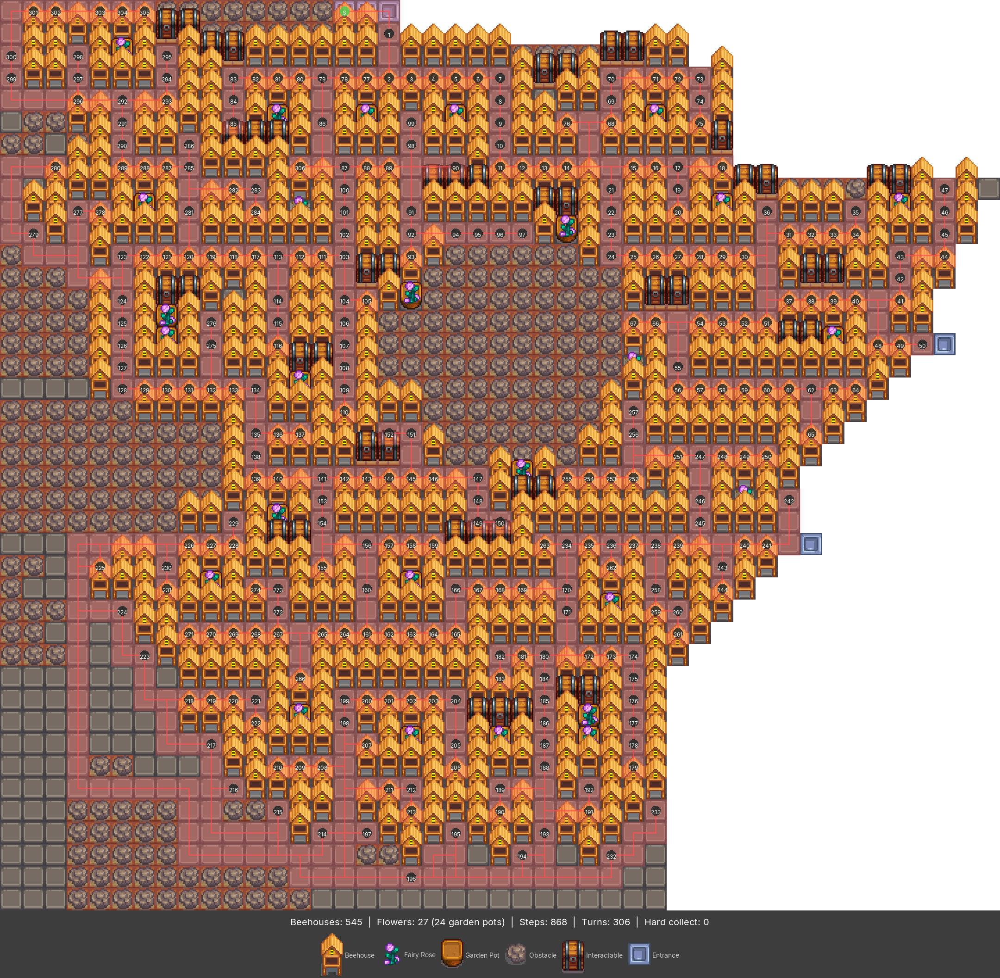

# 545 bee houses with side-only collection

Every house around the west-bank pond can be harvested by standing directly above, below, left or right of it. The layout keeps **91% of the 600-house plan’s yield**, uses the same 24 garden pots and shields all 27 Fairy Roses. A full harvest sells for **518,840g with Artisan**. [Fairy Rose Honey prices](https://stardewvalleywiki.com/Honey)

| Build on the same terrain | Total houses | Houses reachable from a side | Garden pots |
|---|---:|---:|---:|
| Published controller-friendly build | 571 | 431 | 41 |
| Opti-Harvest 600-house build | 600 | 446 | 24 |
| Opti-Harvest side-only build | 545 | **545** | 24 |

The side-access count measures each layout as built. We flood-filled open tiles from the same northern entrance and counted houses touching that connected area on a side. Redesigning the 600-house layout gains **99 side-accessible pickups**. [Original 571-house layout](https://blow.sg/blog/stardew-beehouse-layout) · [600-house plan](../README.md)

| Build map | Harvest walk |
|:---:|:---:|
| [](545-houses.png) | [](545-houses-route.png) |

Plant three roses in soil and 24 in garden pots before enclosing them with houses. Follow the red route from the green **S** at column 16, row 1. Collect at the start, then at the 306 numbered stops. The verified walk returns to **S** after **868 steps**. All five entrances stay connected, and each rose has all eight neighboring tiles inside the survey. [Tile grid](545-houses.txt) · [Turn-by-turn walk](harvest-walk.txt)

CP-SAT rearranged overlapping patches of the previous build and independently grew a second layout from empty ground. We combined sections of the two and solved the strip along their join. The result is a feasible layout on Bryan Low’s terrain transcription. Global optimality and in-game playtesting remain open. The maps use ConcernedApe’s sprites and [Bryan Low’s renderer](https://github.com/keyute/stardew-beehouse-layout/tree/35060e2bc9881b3fccb4aad528461baeb7f5ef64).

Verify the placements and replay the side-only pickups from the repository root.

```sh
python island.py examples/ginger-island/terrain.txt examples/ginger-island/side-only/545-houses.txt --side-only --guard-edges
python island_route.py examples/ginger-island/terrain.txt examples/ginger-island/side-only/545-houses.txt --side-only --check examples/ginger-island/side-only/harvest-walk.txt
```
