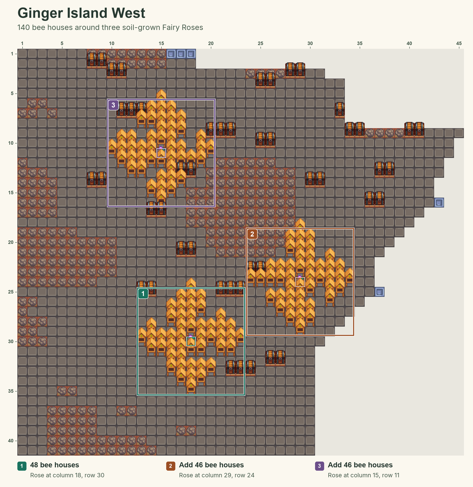

# 48 → 94 → 140 bee houses with three Fairy Roses

Start with one soil-grown Fairy Rose southwest of the pond on Ginger Island West. Two more roses bring the harvest to **140 jars**, with **zero garden pots**. Each expansion adds a separate group of houses. Every house and flower you have already placed stays where it is.

[](three-stages.png)

| Stage | New rose (column, row) | Houses added | Jars per full harvest | Verified round trip |
|---|---|---:|---:|---:|
| [1 · Southwest](stage-1.txt) | (18, 30) | 48 | 48 | [110 steps](walk-1.txt) |
| [2 · Southeast](stage-2.txt) | (29, 24) | 46 | 94 | [190 steps](walk-2.txt) |
| [3 · Northwest](stage-3.txt) | (15, 11) | 46 | 140 | [238 steps](walk-3.txt) |

Open the map at full size. Columns increase to the right and rows increase downward, starting at 1 in the upper-left corner of the survey. Each outlined 11×11 box contains one module. The small square inside it marks the rose. Plant and water the rose before surrounding it with bee houses. The main crop field across the river stays free. At the Artisan price of 952g per jar, stage three yields **133,280g per full harvest**. [Honey prices](https://stardewvalleywiki.com/Honey)

## Harvesting

The walks begin and end at the leftmost northern entrance, column 16, row 1. Walk on the open floor using cardinal steps. Collect from the adjacent eight tiles, including diagonals. Each numbered stage keeps all five entrance tiles connected. Every rose is shielded against picking on all eight sides, entirely inside the surveyed terrain. For every house, at least one reachable collection position is either side-adjacent or a diagonal pickup clear of nearby interactable obstacles. Both the project's flood-fill and Bryan Low's controller-friendly validator checked the plans. Verification used the mapped terrain. An in-game playtest is still open. [Terrain and collection rules](../README.md)

## How close are these to the maximum?

**48 is the exact maximum for one shielded rose.** The one-flower CP-SAT benchmark on an open field allows diagonal collection and treats the flower tile as impassable. Its proven maximum is 48. Removing terrain obstacles and opening the perimeter can only add walking routes, so 48 also bounds what one shielded rose can support on the island. Stage one attains it. [One-flower benchmark](../../open-field.md#how-the-grid-size-changes-the-answer)

With several shielded roses, assign each house to one rose within range. Keep just that rose and its assigned houses, then open up the surrounding terrain. Every original collection route remains usable, and it already avoids the shielded rose. The one-flower bound applies to each group. Two roses therefore allow **at most 96** houses and three allow **at most 144**, even with overlapping flower ranges. Stages two and three are within two and four houses of those bounds. Their exact island maxima remain open.

## Verify a stage

Run these commands from the project root. Use the matching stage and walk number for each build.

```sh
maps=examples/ginger-island
python island.py "$maps/terrain.txt" "$maps/soil-starters/stage-3.txt" --guard-edges
python island_route.py "$maps/terrain.txt" "$maps/soil-starters/stage-3.txt" --check "$maps/soil-starters/walk-3.txt"
```

The map uses ConcernedApe's Stardew Valley sprites and Bryan Low's terrain and renderer. [Reference repository](https://github.com/keyute/stardew-beehouse-layout/tree/35060e2bc9881b3fccb4aad528461baeb7f5ef64)
