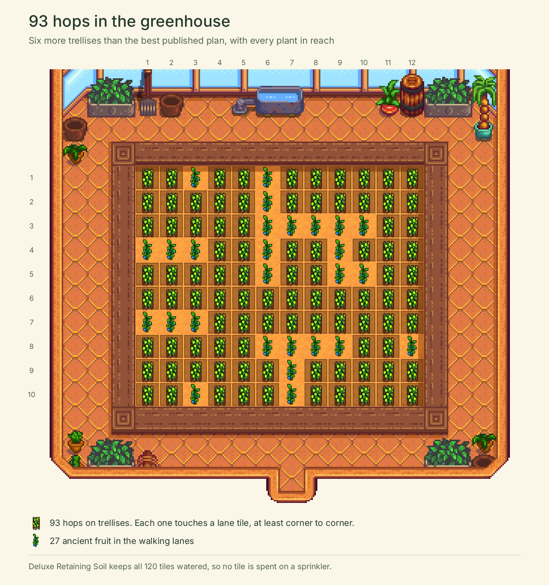
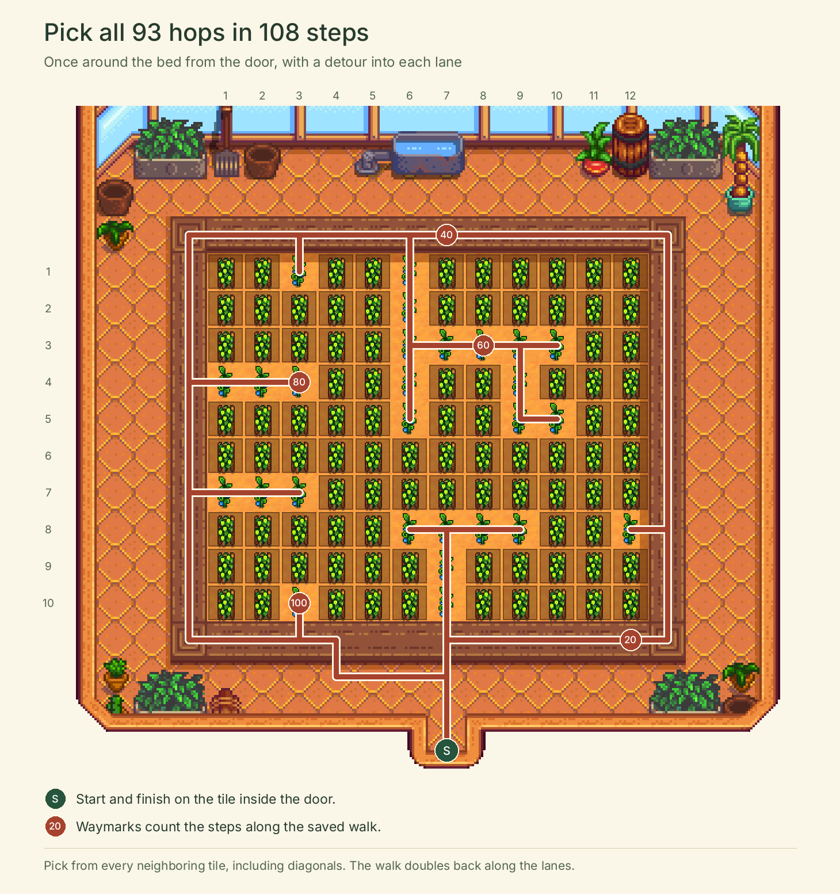
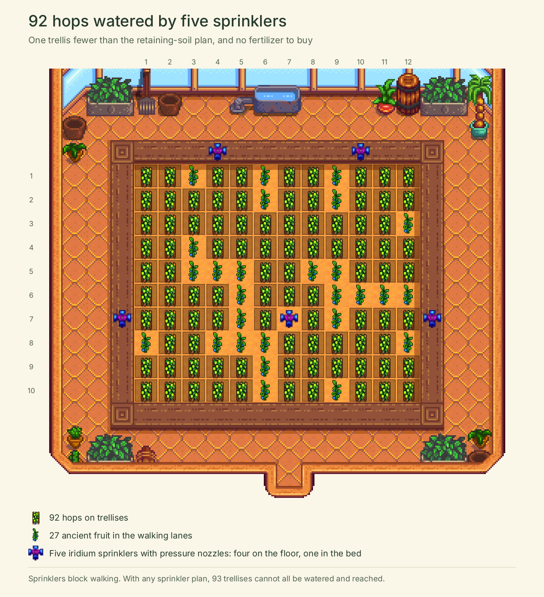
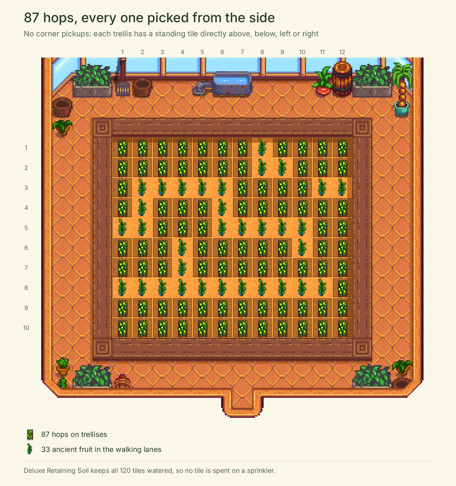
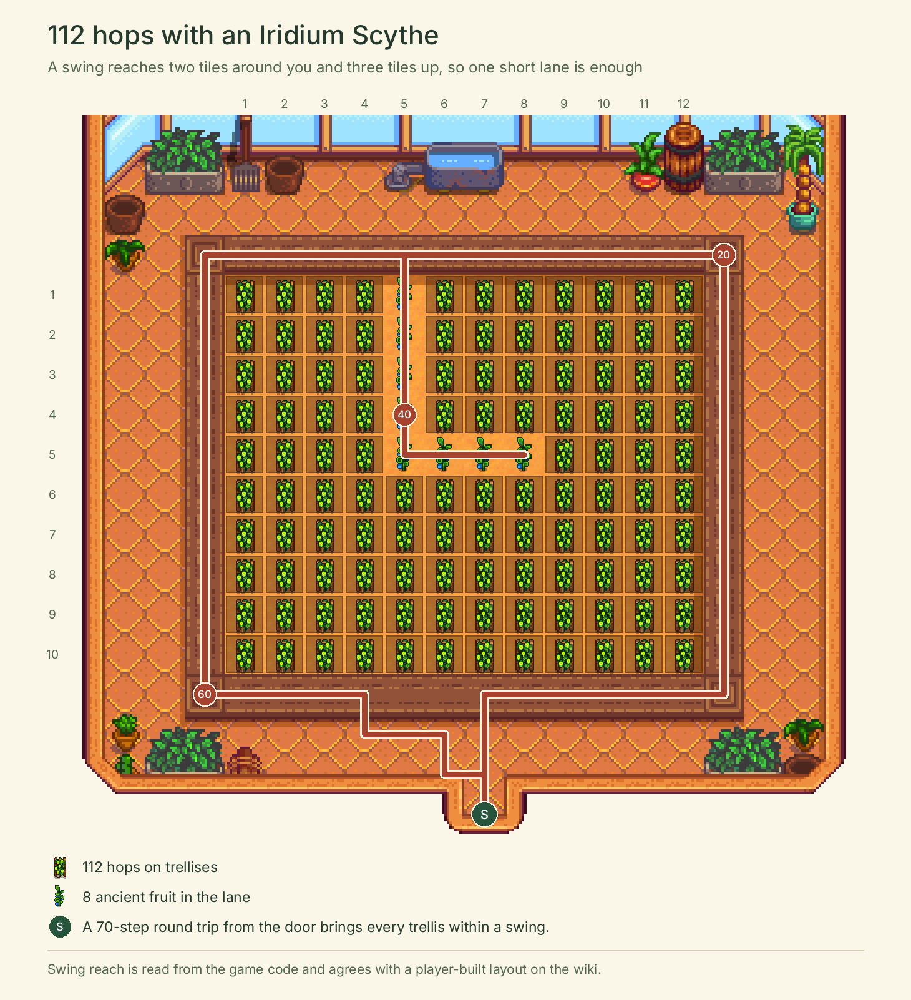

# 93 hops in the greenhouse

Plant **93 hops and 27 ancient fruit** on the greenhouse's 120 soil tiles. Trellis crops block walking, so each one needs a tile beside it where you can stand. This plan keeps all 93 within picking range, and no plan picked by hand can hold more. A **108-step round trip** from the door harvests every hop.

| Build map | Daily harvest |
|:---:|:---:|
| [](build-map.png) | [](harvest-route.png) |

On the wiki's Greenhouse talk page, players planted 90 trellis crops under sprinklers but could reach only 85 of them, then got to 87 by removing three. That 87 has stood as the best known since April 2024, and an editor asked for a proof before adding any layout to the article. With pressure-nozzle sprinklers this bed holds **92**. Deluxe Retaining Soil frees the last tile for the 93rd, and a counting argument shows that 93 is the limit. [Trellis discussion on the wiki](https://stardewvalleywiki.com/Talk:Greenhouse)

## Build it

1. Till all 120 tiles and spread **Deluxe Retaining Soil** on each one. Soil treated with it stays watered after a single watering. Each unit takes 5 Stone, 3 Fiber and 1 Clay, and the recipe costs 50 Cinder Shards at the Island Trader. [Deluxe Retaining Soil](https://stardewvalleywiki.com/Deluxe_Retaining_Soil)
2. Plant Hops Starters on the trellis tiles and Ancient Seeds on the lane tiles, then water everything once. Columns and rows on the map start at 1 at the upper left of the soil. Plant from the lanes and from the floor around the bed. Every trellis tile is within reach of one of them. [Tile plan](93-hops.txt) · [Hops](https://stardewvalleywiki.com/Hops) · [Ancient Fruit](https://stardewvalleywiki.com/Ancient_Fruit)
3. Hops mature in 11 days and then give a harvest every day. Follow the red route from **S**, the tile inside the door. Each token in the saved walk is a direction and a tile count, so `N3` means three steps north. [Daily walk](93-hops-walk.txt)
4. Once a week the ancient fruit is ready too. You walk over or beside every lane plant on the same route.

In the tile plans, `T` is a trellis crop, `A` is a crop you can walk through, `@` is a sprinkler with a pressure nozzle, `.` is floor, `E` is the tile inside the door and `X` is wall. With a mouse you can pick a crop on any of the eight tiles around you. [Trellis crops](https://stardewvalleywiki.com/Crops#Trellis_Crops)

## Is it worth the daily walk?

At base prices, a hops plant gives one Pale Ale worth 300g every day. An ancient fruit plant gives one wine worth 1,650g every seven days, or about 236g a day.

| Greenhouse | Kegs kept busy | Gold per day |
|---|---:|---:|
| 120 ancient fruit | 120 | 28,286 |
| 93 hops and 27 ancient fruit | about 213 | **34,264** |

That is **21% more gold** for a daily harvest and many more kegs. Pale Ale takes a little over a day and a half to brew, so allow two kegs per hops plant if you refill once a day. Two Big Sheds hold 274 kegs. The Artisan profession raises both rows by the same 40%. [Pale Ale](https://stardewvalleywiki.com/Pale_Ale) · [Wine](https://stardewvalleywiki.com/Wine) · [137 kegs in a Big Shed](../machine-rooms/README.md)

## Other ways to water and pick

| Plan | Pick with | Water with | Hops | Lane crops | Daily walk |
|---|---|---|---:|---:|---:|
| [93 hops](93-hops.txt) | Mouse | Deluxe Retaining Soil | **93** | 27 | [108 steps](93-hops-walk.txt) |
| [92 hops](92-hops-sprinklers.txt) | Mouse | Five pressure-nozzle sprinklers | **92** | 27 | [116 steps](92-hops-sprinklers-walk.txt) |
| [87 hops](87-hops-side.txt) | Side only | Deluxe Retaining Soil | **87** | 33 | [120 steps](87-hops-side-walk.txt) |
| [112 hops](112-hops-scythe.txt) | Iridium Scythe | Deluxe Retaining Soil | **112** | 8 | [70 steps](112-hops-scythe-walk.txt) |
| [84 hops](84-hops-short-lap.txt) | Mouse | Deluxe Retaining Soil | 84 | 36 | [66 steps](84-hops-short-lap-walk.txt) |

The first four hop counts are **proven maxima** for their rules. Each walk is the shortest round trip from the door on its saved plan. The last row gives up nine trellises for a lap that is 42 steps shorter.

| 92 hops with sprinklers | 87 hops with no corner pickups |
|:---:|:---:|
| [](sprinklers.png) | [](side-only.png) |

**Sprinklers.** A sprinkler blocks walking and takes the tile it stands on. Four of the five stand on the floor around the bed, where they cost no soil. [Pressure Nozzle](https://stardewvalleywiki.com/Pressure_Nozzle)

**No corner pickups.** Console and mobile players often cannot reach into corners. In the side-only plan every trellis has a lane tile directly above, below, left or right of it. That costs six trellises.

### With an Iridium Scythe

The Iridium Scythe harvests every crop its swing passes over, trellis crops included. Reading the swing from the game code, the four swings from one tile can reach this pattern around the farmer `F`, with north at the top.

```
· ■ ■ ■ ·
■ ■ ■ ■ ■
■ ■ ■ ■ ■
■ ■ F ■ ■
■ ■ ■ ■ ■
■ ■ ■ ■ ■
```

That is two tiles in every direction and three tiles upward. With it the bed holds **112 hops** around one L-shaped lane of eight tiles, and the daily round trip drops to **70 steps**.

[](scythe.png)

The far tiles depend on where you stand on your tile. Wherever you stand, the four swings cover 17 of the 27. For the rest, press against the plants on the side you want to reach before you swing.

**The pattern comes from the code for version 1.6.15. We have not swung a scythe in the game ourselves.** It does agree with a player-built layout on the wiki, a Big Shed with 168 garden pots harvested by Iridium Scythe. Every pot there lies inside this pattern from some aisle tile, and the three tiles left for lamps are exactly the ones the pattern cannot reach. Try one lane before you replant the whole bed. [Iridium Scythe](https://stardewvalleywiki.com/Iridium_Scythe) · [168-pot layout on the wiki](https://stardewvalleywiki.com/Shed) · [Our transcription](wiki-168-pots.txt)

## Why 93 is the limit

Suppose you leave $w$ soil tiles open for walking. The trellises number at most $120-w$.

The 40 tiles on the edge of the bed can be picked from the floor around it. The other 80 can only be picked from inside. Grow the lanes one tile at a time. Each step onto a new soil tile moves your 3×3 reach one tile over, which brings **at most three** new inner tiles within reach. So at most $3w$ inner tiles ever come within reach. Every lane tile also takes a trellis spot, on the edge or inside. That leaves at most $40+3w-w=40+2w$ trellises.

Add twice the first bound to the second. Three times the trellis count is at most 280, so there are at most **93**. The same argument gives an exact formula for bee houses on any open rectangle. [Open-rectangle proof](../open-field.md#why-there-is-an-exact-formula-for-open-rectangles)

A plan with 93 trellises has no tile to spare. It needs exactly 27 lane tiles, which leaves no room for a sprinkler in the bed, and sprinklers on the floor around the bed cannot reach its middle. CP-SAT confirms that 93 watered trellises are impossible with sprinklers, and that 87 and 112 are the limits for side-only picking and for the scythe pattern above. [Solver and checker](../../greenhouse.py)

## Reproduce

From the repository root with the project dependencies installed, run

```sh
python greenhouse.py --check examples/hops-greenhouse/93-hops.txt --replay examples/hops-greenhouse/93-hops-walk.txt
python greenhouse.py --check examples/hops-greenhouse/93-hops.txt --walk daily
python greenhouse.py --check examples/hops-greenhouse/87-hops-side.txt --reach side
python greenhouse.py --solve --sprinklers @
python greenhouse.py --prove
```

The checker flood-fills the open floor from the door, then tests every trellis for a standing tile within reach and every crop for water. `--walk daily` finds the shortest round trip that passes a picking tile for every trellis. `--prove` reruns the search for each saved maximum and checks that its upper bound matches, which takes under a minute. Steps measure tile movement. Turning and picking take additional playing time. These are computational results awaiting an in-game playtest.

The bed and floor shapes come from the game's greenhouse map. Harvest reach, trellis blocking, sprinkler ranges and the scythe swing were read from decompiled game code for version 1.6.15.

Stardew Valley artwork by ConcernedApe. The greenhouse background and the crop and sprinkler sprites come from Henrik Peinar’s Stardew Valley Planner. Crops are scaled to one tile so each position stays legible. [Planner](https://stardew.info/planner/) · [Sprite atlas](https://stardew.info/planner/assets/tilesheets/sprites.png)
