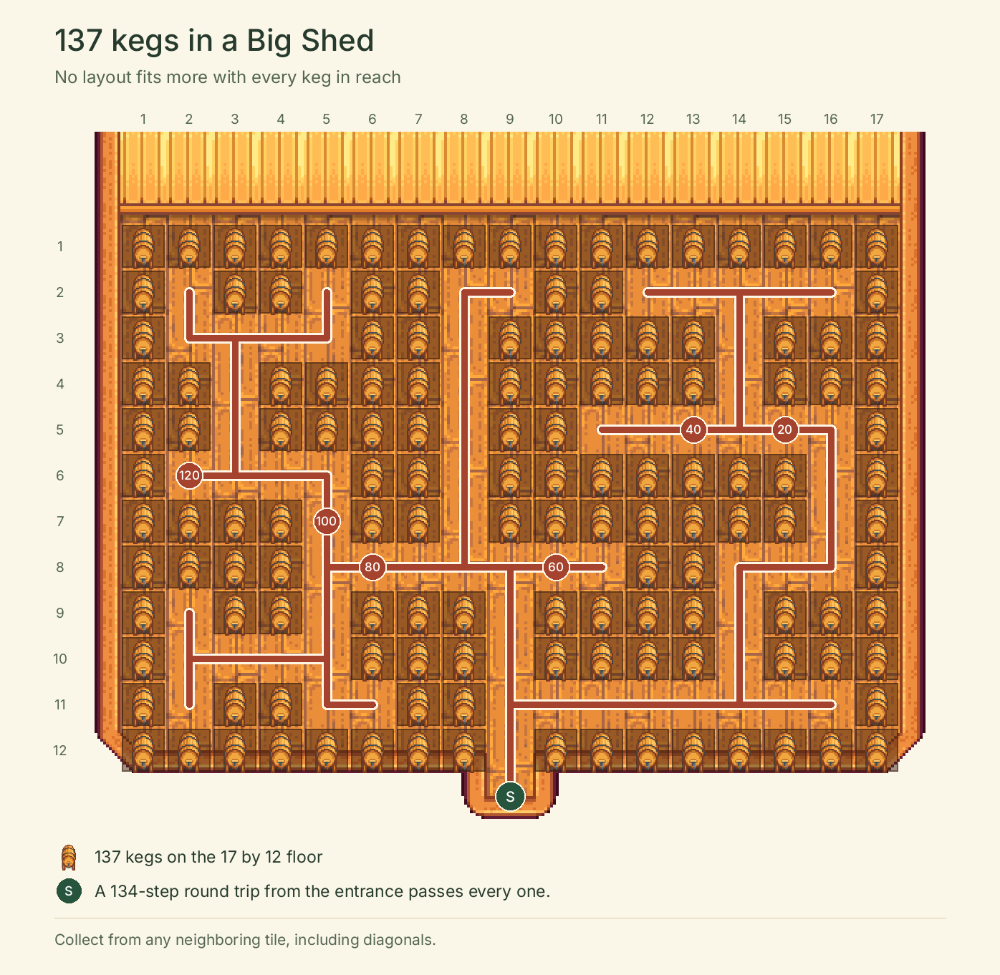
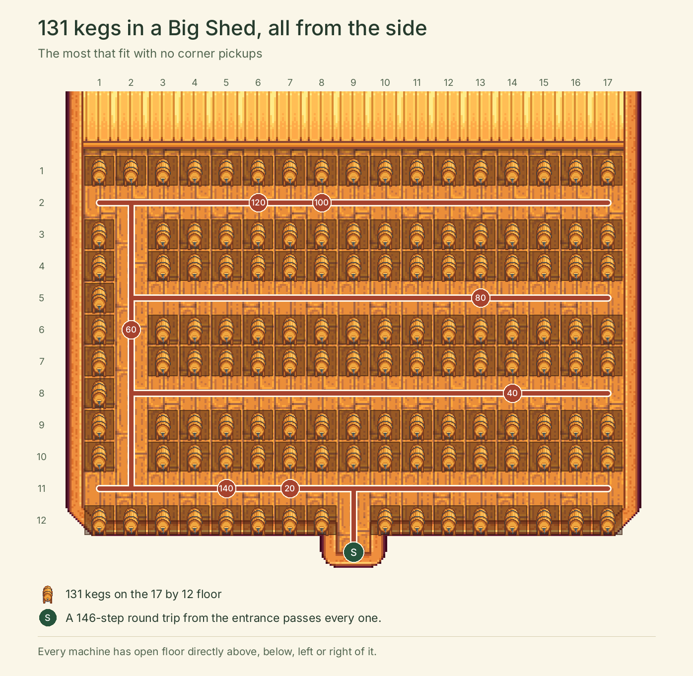
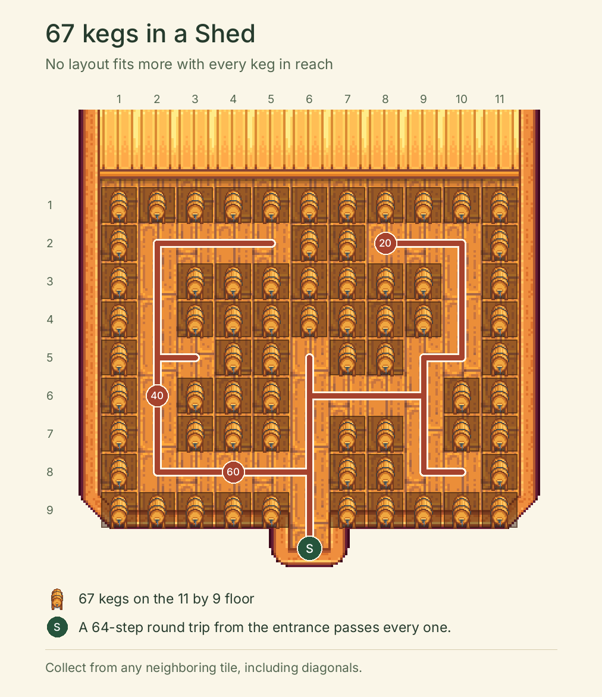
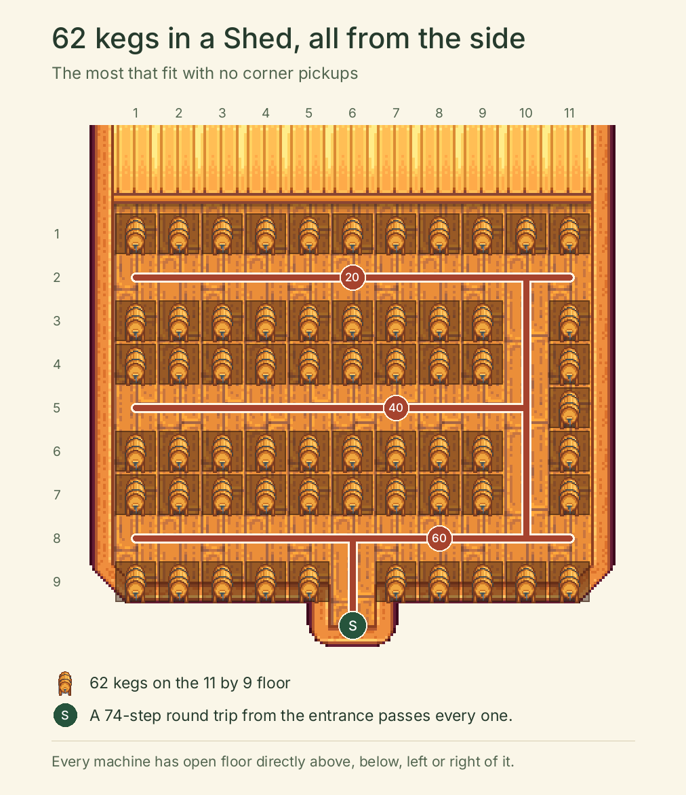
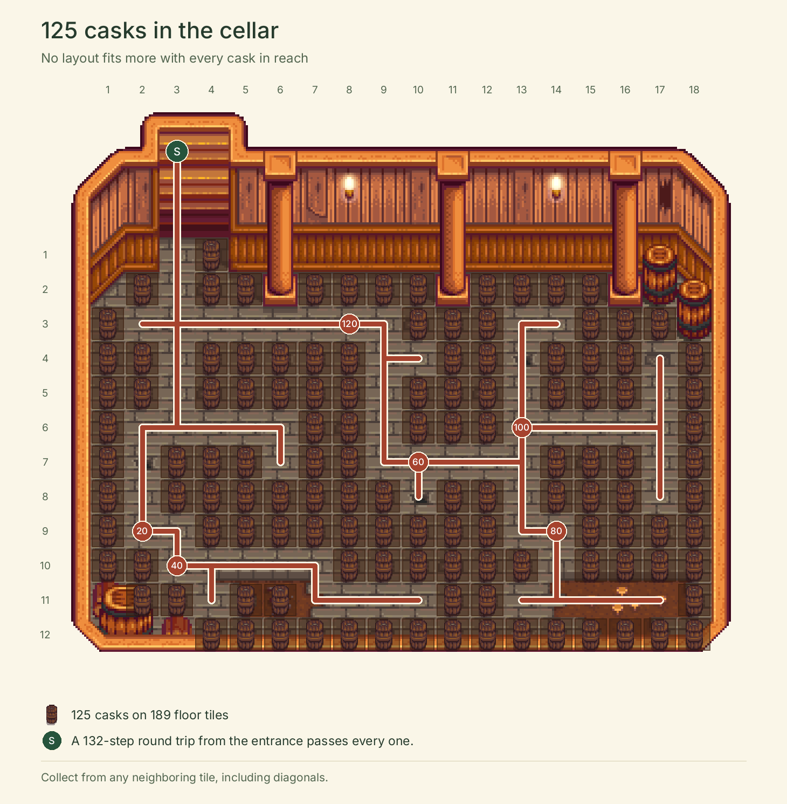
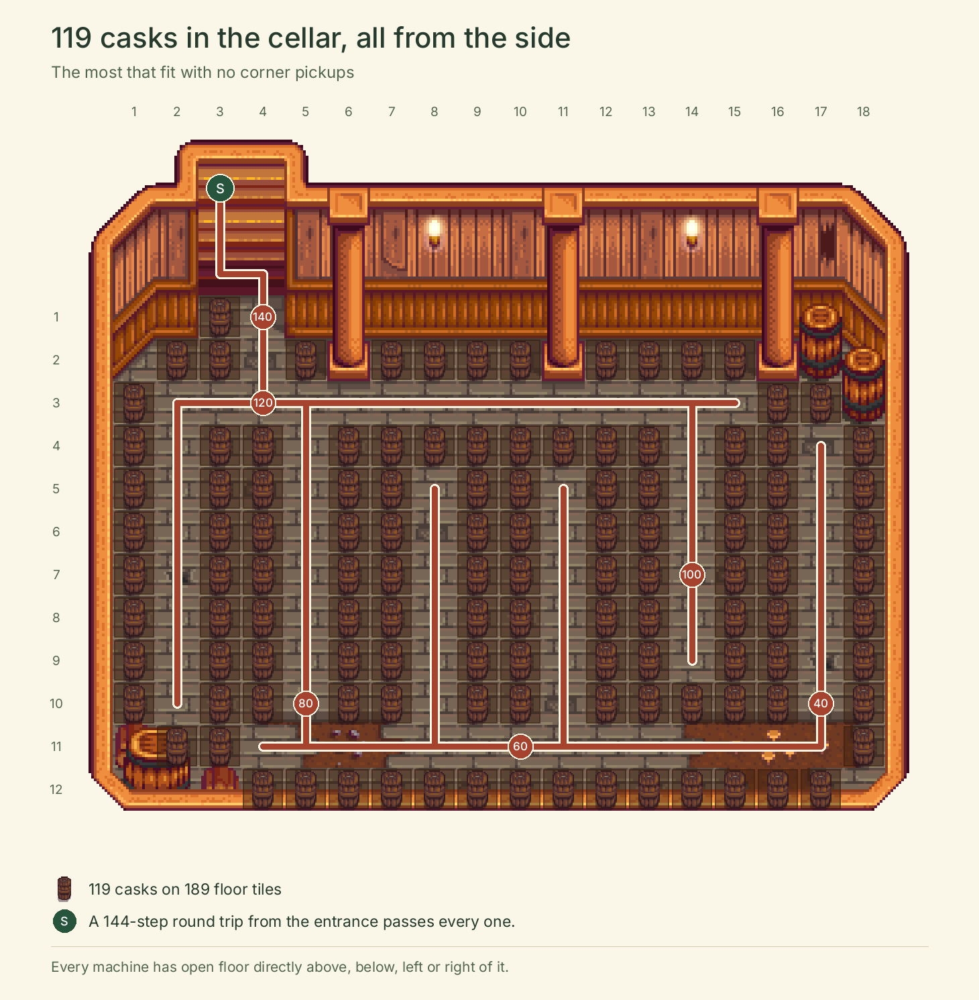

# How many kegs fit in a shed?

A Shed holds at most **67 machines** and a Big Shed at most **137** if you want to reach every one of them. The layouts players already use hit those numbers, and a short counting argument shows that nothing can beat them. The cellar tops out at **125 casks**. Without corner pickups, where every machine has open floor directly beside it, the limits are **62, 131 and 119**.

| Room | Floor tiles | Collect from any neighboring tile | Collect from the side only |
|---|---:|---:|---:|
| Shed | 99 | [**67**](shed.txt) | [**62**](shed-side.txt) |
| Big Shed | 204 | [**137**](big-shed.txt) | [**131**](big-shed-side.txt) |
| Cellar | 189 | [**125**](cellar.txt) | [**119**](cellar-side.txt) |

Every number in the table is a proven maximum for that room and pickup rule.

| 137 kegs in a Big Shed | 131 kegs, all from the side |
|:---:|:---:|
| [](big-shed.png) | [](big-shed-side.png) |

## Build it

1. Pick the plan for the way you play. With a mouse you can collect from all eight neighboring tiles. Console and mobile players often cannot reach into corners, so use a side-only plan, where every machine has open floor directly above, below, left or right of it. The side-only plans also work with a mouse.
2. On each map, columns and rows start at 1 on the upper-left floor tile. In the tile plans, `M` is a machine, `.` is open floor, `E` is where you arrive, `W` is the cellar staircase and `X` is wall. The plans cover the whole interior, so the first floor tile sits a few rows down.
3. Start in the corner farthest from the door and work back. Stand on an open tile and place the machines around you. Every machine in a plan has an open tile within reach, so you never have to lift one to get at another.
4. Follow the red route from **S** to pass within reach of every machine and return. Each token in a saved walk is a direction and a tile count, so `N3` means three steps north.

The counts hold for any machine that fills one tile, such as kegs, preserves jars, dehydrators and crystalariums. Casks only age their contents in the cellar. [Shed](https://stardewvalleywiki.com/Shed) · [Keg](https://stardewvalleywiki.com/Keg) · [Cask](https://stardewvalleywiki.com/Cask)

## Every room

| Shed, 67 | Shed, 62 from the side |
|:---:|:---:|
| [](shed.png) | [](shed-side.png) |

| Cellar, 125 | Cellar, 119 from the side |
|:---:|:---:|
| [](cellar.png) | [](cellar-side.png) |

A round trip from the entrance that passes within reach of every machine takes this many steps. Each is the shortest possible on its saved plan.

| Room | Any neighboring tile | Side only |
|---|---:|---:|
| Shed | [64 steps](shed-walk.txt) | [74 steps](shed-side-walk.txt) |
| Big Shed | [134 steps](big-shed-walk.txt) | [146 steps](big-shed-side-walk.txt) |
| Cellar | [132 steps](cellar-walk.txt) | [144 steps](cellar-side-walk.txt) |

## What was already known

The wiki's Shed page shows a 67-space Shed and a 137-space Big Shed and calls them optimal for mouse and keyboard. Neither comes with a proof. The counting argument below supplies one. [Shed layouts on the wiki](https://stardewvalleywiki.com/Shed)

The same page warns that equipment in corners usually cannot be reached with a controller. On its talk page, a Steam Deck player counted 16 such spots in the 137 layout and was looking for a layout without them. With no corner pickups the limit is **131**, six fewer than with a mouse. [Shed talk page](https://stardewvalleywiki.com/Talk:Shed)

For the cellar, the wiki gives 125 casks on PC and calls 118 the maximum on mobile, where corners cannot be reached. A 2026 comment on the talk page reports a 119-cask mobile layout from Reddit. Side-only pickups allow exactly **119** and no more. [Cask](https://stardewvalleywiki.com/Cask) · [Cask talk page](https://stardewvalleywiki.com/Talk:Cask)

**What a controller really reaches.** In the 1.6.15 game code, the action button first tries the tile you are facing. If that tile has nothing to give, it tries the tile below it and then the tile above it, as long as they touch your own tile. So a controller picks up a corner machine only while you face left or right, and only when the tile straight ahead has nothing to give. The side-only plans never need that.

## Why a Big Shed stops at 137

Let $F$ be the number of floor tiles and $w$ the number you leave open. Machines fill the rest at most, so there are no more than $F-w$ of them.

Now grow the walkway one tile at a time from the door. Standing in the doorway you can reach three floor tiles. Each step onto a new tile moves your 3×3 reach one tile over, which brings **at most three** new tiles within reach. After opening $w$ tiles, at most $3+3w$ floor tiles have ever been within reach. Every open tile was reached before you stepped on it, and every machine must be reached too. That leaves room for at most $3+2w$ machines.

Add twice the first bound to the second. Three times the machine count is at most $2F+3$.

| Room | $F$ | Tiles in reach on arrival | Counting bound | Best plan |
|---|---:|---:|---:|---:|
| Shed | 99 | 3 | $\lfloor 201/3\rfloor = 67$ | 67 |
| Big Shed | 204 | 3 | $\lfloor 411/3\rfloor = 137$ | 137 |
| Cellar | 189 | 2 | $\lfloor 380/3\rfloor = 126$ | 125 |

Both sheds meet the bound with nothing to spare. Every single step of the walkway has to bring three fresh tiles into reach, which is why the walkways branch like a comb and never run side by side.

The cellar misses by one. Its staircase, pillars and corner barrels break up the floor, and CP-SAT shows that no walkway reaches 126 casks. The side-only limits also come from CP-SAT, since the same counting argument only gives 66, 136 and 126. A side-only walkway wastes reach at every corner, because the tile inside the turn is reached from both arms. That is why the best side-only plans are long straight aisles. [Solver and checker](../../machine_room.py)

## Reproduce

From the repository root with the project dependencies installed, run

```sh
python machine_room.py --check examples/machine-rooms/big-shed.txt --walk
python machine_room.py --check examples/machine-rooms/cellar-side.txt --side-only
python machine_room.py --solve examples/machine-rooms/shed.txt --side-only
python machine_room.py --prove
```

The checker flood-fills the open floor from the entrance and tests every machine for an open tile within reach. `--prove` compares each saved plan with the counting bound. Where the bound is higher, it reruns the CP-SAT search and checks that the solver's own upper bound comes down to the saved count. With four workers the solver proofs took between five and ten minutes in our runs, most of it on the side-only cellar. Each search stops as soon as its bound closes, and `--seconds` raises the half-hour limit per room. The step counts measure tile movement. Turning, collecting and refilling take additional playing time. These are computational results awaiting an in-game playtest.

Room shapes come from the game's interior maps. The cellar plan keeps the walk off the two tiles at the top of the stairs that lead back to the farmhouse.

Stardew Valley artwork by ConcernedApe. The room backgrounds and the keg and cask sprites come from Henrik Peinar’s Stardew Valley Planner. Machines are scaled to one tile so each position stays legible. [Planner](https://stardew.info/planner/) · [Sprite atlas](https://stardew.info/planner/assets/tilesheets/sprites.png)
