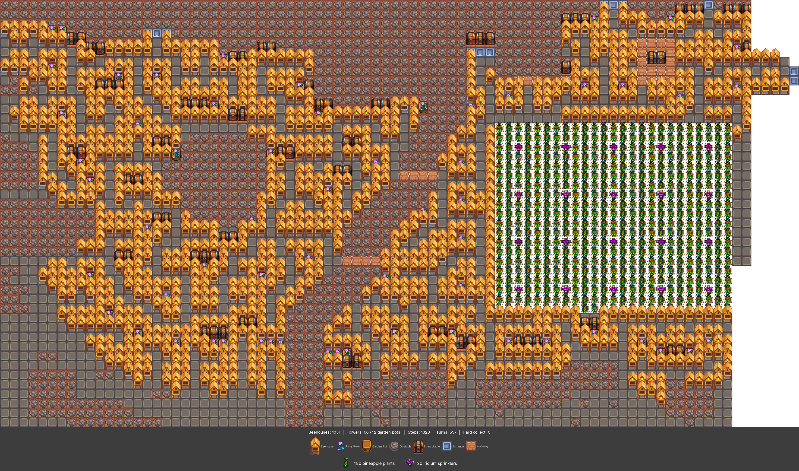
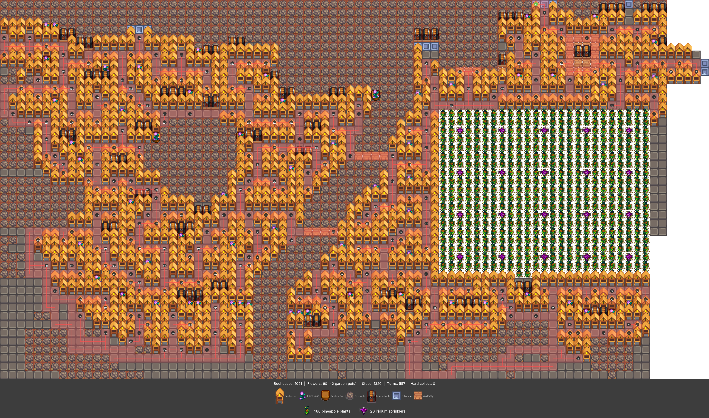

# A million-gold honey harvest alongside 480 crops

On the southern part of Ginger Island West, **1,051 bee houses and a 25×20 crop field fit together**. Twenty ordinary iridium sprinklers water 480 pineapple plants. The honey collection route stays outside the field, so you can harvest honey without walking through the crops.

| Build map | Verified harvest walk |
|:---:|:---:|
| [](build-map.png) | [](harvest-route.png) |

| What you get | Verified layout |
|---|---:|
| Fairy Rose Honey per full harvest | 1,051 jars |
| Gross honey sales with Artisan | 1,000,552g |
| Protected Fairy Roses | 60 (18 in soil, 42 in garden pots) |
| Irrigated crop tiles | 480 |
| Honey collection walk | 1,320 steps, returning to the entrance |
| Houses requiring diagonal collection | 251 |

A player already demonstrated a protected **1,051-house** island build in-game. We used that million-gold milestone as the target and reserved a contiguous, sprinkler-ready field before placing the extra houses. The earlier author used a different footprint and did not report a comparable crop count. At 952g per jar with Artisan, 1,050 houses come to 999,600g. House 1,051 takes the honey alone over a million. Bee houses on Ginger Island produce every four days. [Player’s original build](https://www.reddit.com/r/StardewValley/comments/1e99h1f/) · [Honey prices and production](https://stardewvalleywiki.com/Honey)

## Building it

1. Use the [tile grid](farm.txt) and the west-bank pond and bridges to orient the map. Coordinates below start at **column 1, row 1** in the upper-left corner of the combined survey. The crop rectangle runs from **column 53, row 14** through **column 77, row 33**. Each `C` marks a plant. Each `@` marks a standard iridium sprinkler. Place sprinklers at columns **55, 60, 65, 70 and 75** on each of rows **16, 21, 26 and 31**. Each waters its surrounding 24 crop tiles. [Iridium sprinkler](https://stardewvalleywiki.com/Iridium_Sprinkler)
2. Plant the roses first, using soil for `F` and garden pots for `f`. Water them before closing up their beds with the houses marked `B`. Deluxe Retaining Soil lets one watering carry a flower to maturity. Garden pots support flower honey from Stardew Valley 1.6.6. [Garden pots](https://stardewvalleywiki.com/Garden_Pot) · [Bee House version history](https://stardewvalleywiki.com/Bee_House)
3. Start at the green **S**, column 64, row 1. Collect there and at the 282 numbered pickup tiles along the red route. The [turn-by-turn walk](harvest-walk.txt) gives directions such as `S3` for three tiles south. A four-direction flood-fill connects all 12 marked entrance tiles even with the entire crop field blocked.

Each rose is shielded on all eight sides, entirely inside the mapped terrain. Each house has either a reachable side pickup or a reachable diagonal pickup where nearby interactable obstacles do not interfere under the reference model. Pineapples can be reached for harvest with the sprinkler tiles occupied. Crop sale proceeds and material costs are separate from the honey figure.

## What was checked

We reserved the crop rectangle as an obstacle during CP-SAT search. The smaller west-bank build supplied a starting layout. Its terrain differs at one occupied tile in the larger survey, which left 599 legal starting houses. We rearranged overlapping patches on the eastern bank and then across both banks until the layout reached the target.

The verifier checks flower range, shielding, permitted placements, entrance connectivity, collection access, crop reachability and sprinkler coverage. It replays every step of the saved walk. We also ran Bryan Low’s controller-friendly validator twice, first on the original terrain and then with the whole crop field blocked. This is a feasible design on the hand-transcribed map. Optimality, NPC schedules and real collection time remain unverified. [Reference terrain and validator](https://github.com/keyute/stardew-beehouse-layout/tree/35060e2bc9881b3fccb4aad528461baeb7f5ef64)

Run the check from the repository root.

```sh
d=examples/mixed-farm
python mixed_farm.py "$d/terrain.txt" "$d/farm.txt" --walk "$d/harvest-walk.txt"
```

To repeat the search with the same land reservation, export the masked map to a new directory. Passing the terrain as the starting layout starts with an empty apiary. Passing `honey-search/houses.txt` instead starts with the 1,051-house layout. Local search can find different solutions across runs.

```sh
python mixed_farm.py "$d/terrain.txt" "$d/farm.txt" --export honey-search
python island.py honey-search/terrain.txt honey-search/terrain.txt --max-flowers 150 --max-pots 130 --output honey-search/result.txt --passes 15 --seconds 1.3
```

Terrain and renderer by Bryan Low, using iaia_'s in-game terrain survey. Game art by ConcernedApe. [Combined terrain](https://github.com/keyute/stardew-beehouse-layout/blob/35060e2bc9881b3fccb4aad528461baeb7f5ef64/maps/ginger_island_west_bottom.yml) · [Terrain license](TERRAIN-LICENSE) · [Original survey](https://www.reddit.com/r/StardewValley/comments/1k5rod1/all_plantable_areas_on_ginger_island_farm/) · [Pineapple sprite](https://stardewvalleywiki.com/File:Pineapple_Stage_6.png) · [Sprinkler sprite](https://stardewvalleywiki.com/File:Iridium_Sprinkler.png)
