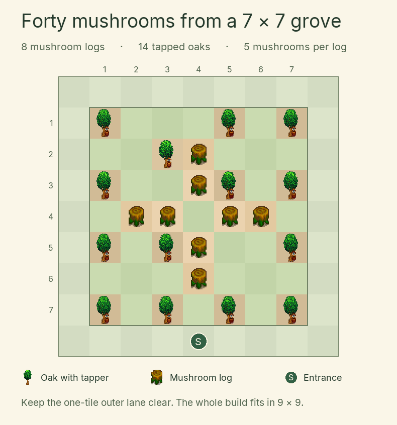
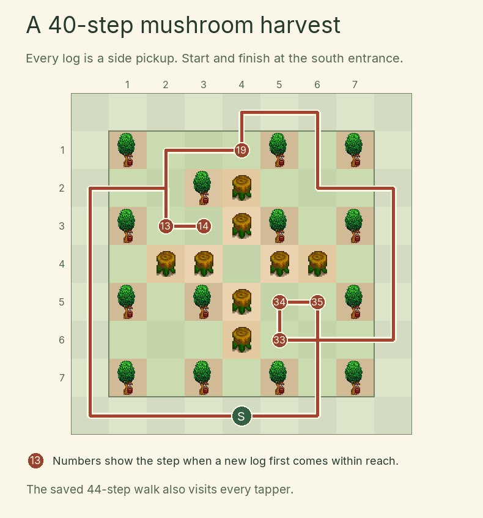
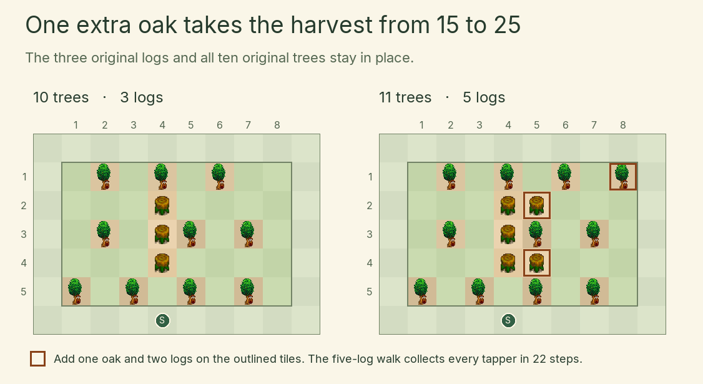

# Forty mushrooms from a 7×7 oak grove

Plant **14 oaks and eight Mushroom Logs** in a 7×7 square. Every ready log gives five mushrooms, and every oak can carry a tapper for Oak Resin. From the south entrance, collect all 40 mushrooms in **40 steps**. When the tappers are ready too, a **44-step round trip** collects both. Each pickup is directly above, below, left or right of a standing tile.

| Build map | Mushroom harvest |
|:---:|:---:|
| [](build-map.png) | [](harvest-route.png) |

## Build it

1. Reserve **9×9 clear tiles** on plantable farmland. The inner 7×7 holds the trunks and logs. The outer ring is walking space. Columns and rows on the map start at 1 at the upper left of the inner square. The entrance is on the outer ring, immediately south of column 4. [Tile plan](14-trees.txt)
2. Plant acorns on the 14 tree tiles. Let them mature, then attach a tapper to each oak. A seedling needs all eight neighboring tiles free of **mature trees** to reach maturity. Every trunk in the plan has that clearance. Keep the lanes free of self-seeded trees. [Tree growth](https://stardewvalleywiki.com/Trees#Growth_Cycle) · [Tappers](https://stardewvalleywiki.com/Tapper)
3. Place the logs after the trees mature. Four go in **column 4 on rows 2, 3, 5 and 6**. The other four go in **row 4 at columns 2, 3, 5 and 6**. Leave the center empty. Eight logs cost 80 Hardwood and 80 Moss at Foraging level 4. [Mushroom Log recipe](https://stardewvalleywiki.com/Mushroom_Log)
4. Follow the red route from **S**. Each token in the saved walk is a direction and a tile count, so `W4` means four steps west. If both products are ready, use the joint walk to pick up **40 mushrooms and 14 Oak Resin**. The mushroom and tapper production timers run independently. [Mushroom walk](mushroom-walk.txt) · [Joint walk](joint-walk.txt) · [Oak Resin](https://stardewvalleywiki.com/Oak_Resin)

A log counts wild trees in the 7×7 square centered on itself. At least ten trees guarantee the maximum stack of five. Seven logs here see exactly ten oaks and the eighth sees eleven. Oak favors Morels, while the species and quality of each batch still vary. Resin is also a crafting ingredient for Kegs. [Mushroom quantity and type](https://stardewvalleywiki.com/Mushroom_Log#Mechanic) · [Keg recipe](https://stardewvalleywiki.com/Keg)

## What changes in an existing tapper orchard?

Player beavernator’s “Basic Cavitated Array” plants a mature tree every other tile in every other row. We took a standalone 7×7 section of that tree pattern, giving 16 oaks in a 4×4 grid, then tried every placement of full-yield logs among them. Both layouts below use the **same 7×7 planting square, clear outer lane and side-only pickup rule**. The player’s full repeating forest has additional trees beyond a section’s edges. [Published tree and log patterns](https://www.reddit.com/r/StardewValley/comments/1ngrsvh/found_a_new_more_efficient_mushroom_log_farm/)

| Layout | Tappable oaks | Guaranteed five-mushroom logs | Mushrooms from those logs per full harvest |
|---|---:|---:|---:|
| [Regular 4×4 tapper grid](regular-grid.txt) | 16 | 6 | 30 |
| [Optimized grove](14-trees.txt) | 14 | 8 | 40 |

The redesign trades two resin taps for two more full-yield logs. Both counts use trees grown to maturity in place, and all the boosting trees are shown. Immature saplings also count for mushroom quantity in the game. Filling gaps with saplings, allowing diagonal collection, or harvesting extra logs at variable yields changes the comparison. Players have also built dense repeating mushroom forests. Mushroom Masher compares those patterns by yield per tile across repeated blocks. [Player designs and comparison](https://github.com/fwiffo/mushroom-masher#sample-layouts)

## Start with ten trees

With fewer materials, start with **ten oaks and three logs**. Once the eleventh oak matures, place two more logs. The harvest goes from **15 to 25 mushrooms**, with every earlier tree and log in the same place. The planting area is 8×5, or 10×7 including its walking ring. At stage two, one **22-step** walk visits all five logs and all eleven tappers. From **S**, walk `W2 N2 E1 N4 E4 S2 W1 S4 W2`.

[](starter.png)

| Mature trees available | Full-yield logs | Guaranteed mushrooms | Shortest mushroom round trip on the saved plan |
|---:|---:|---:|---:|
| [10](10-trees.txt) | 3 | 15 | 14 steps |
| [11](11-trees.txt) | 5 | 25 | 22 steps |
| [12](12-trees.txt) | 6 | 30 | 30 steps |
| [13](13-trees.txt) | 7 | 35 | 44 steps |
| [14](14-trees.txt) | 8 | 40 | 40 steps |

The 10- and 11-tree plans are consecutive stages. The 12-, 13- and 14-tree rows are separate builds. For budgets of **10 through 13 mature trees**, the log counts are exact maxima even on an arbitrarily large open field. **Fourteen is the minimum tree count for eight full-yield logs** under these rules.

## Why eight logs is the limit

A 2×2 block holds at most one mature trunk. Partitioning a rectangle into blocks of at most 2×2 therefore bounds the number of mature trees it can contain.

- A log on the outer edge sees at most a 4×7 portion of the planted grove. That holds at most eight mature trees.
- A log off both the middle row and the middle column sees at most 6×6. That holds at most nine trees.
- This leaves just **nine possible log sites** on the middle cross. Filling all nine puts logs on all four sides of the central log and blocks its collection. The published layout fills eight, attaining the upper bound.

**Why a larger field cannot save the fourteenth tree.** With a budget of 13, any two five-mushroom logs must share at least seven trees, since each needs ten. If their centers differ by five columns, the overlap is at most 2×7 and could contain only four mature trees. A larger separation shrinks it further. The same holds for rows, so all qualifying log centers fit inside a 5×5 window anywhere on the farm.

The proof script enumerates log patterns in that window. It eliminates pairs whose overlap holds too few mature trees, patterns with a log boxed in on all four sides, and rotations or reflections of the same pattern. Only **five eight-log patterns** remain for the 13-tree budget. On each, CP-SAT checks every possible supporting tree position, growth clearance, and connected side access to every log and tapper. All five patterns are infeasible. Removing surplus logs from a larger build would preserve access and coverage, so the same exclusion applies to any build with more logs. The script repeats the argument for the smaller budgets. [Executable proof and layout checker](../../mushroom_grove.py)

## Reproduce

From the repository root with the project dependencies installed, run

```sh
python mushroom_grove.py --check examples/mushroom-grove/14-trees.txt --walk logs
python mushroom_grove.py --check examples/mushroom-grove/14-trees.txt --walk all
python mushroom_grove.py --prove
python mushroom_grove.py --find 11 5
```

The checker flood-fills the printed plan from its entrance, counts the trees around each log, and checks every side pickup. Breadth-first search over the farmer's tile and the pickups already covered gives the shortest round trip on each fixed plan. Steps measure tile movement. Turning, targeting items through tree canopies and collecting take additional playing time. These are computational results awaiting an in-game playtest.

Stardew Valley artwork by ConcernedApe. The oak, tapper and mushroom log sprites come from Henrik Peinar’s Stardew Valley Planner. Trees are scaled to one tile so the trunk positions stay legible. [Planner](https://stardew.info/planner/) · [Sprite atlas](https://stardew.info/planner/assets/tilesheets/sprites.png)
