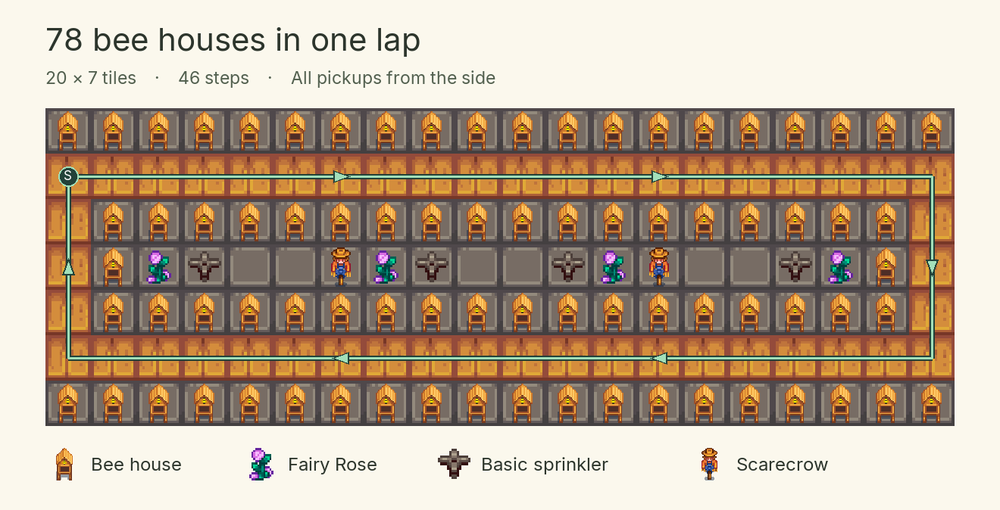

# 78 bee houses in one 46-step lap

On a 20×7 strip, four basic sprinklers water four protected flowers that supply **78 bee houses**. Every jar can be collected from the side. Walk east 19 tiles, south 4, west 19 and north 4 to return to the entrance. The entire walk fits inside the plot.

[](build-map.png)

| 20×7 build | Houses | Flowers | Basic sprinklers |
|---|---:|---:|---:|
| Published three-lane layout | 68 | 6 | 6 |
| One-lap layout | **78** | **4** | **4** |

The comparison comes from a player's request for a honey farm on exactly this footprint. Counting the four planting rows in the published reply gives 20 + 14 + 20 + 14 houses. The author suggests adding scarecrows where needed. Our footprint includes two ordinary scarecrows, and the roses are shielded even against accidental diagonal picking. [Original 20×7 layout](https://www.reddit.com/r/StardewValley/comments/zqd7dg/)

## Building it

Use sprinkler-compatible farmland. Plant the roses first, all on the middle row, at columns **3, 8, 13 and 18**, counting from the left. Put one basic sprinkler directly beside each rose. Each rose sits within four horizontal tiles of a scarecrow. To replace a seasonal flower, lift the house immediately above it, step in from the upper lane, replant and put the house back. [Sprinkler watering pattern](https://stardewvalleywiki.com/Sprinkler) and [scarecrow range](https://stardewvalleywiki.com/Scarecrow)

The green **S** on the map marks the entrance. In the [plain-text plan](layout.txt), `H` is a bee house, `F` is a flower, `S` is a sprinkler, `C` is a scarecrow and `.` is clear ground. Flooring is optional. The 46 steps measure movement between tiles. Turning the farmer and collecting honey take additional time.

Place a second copy immediately to the east for **156 houses in 40×7**. The upper lanes connect across the seam. From the original entrance walk **E39, S4, W19, N4, W1, S4, W19, N4** for a verified 94-step round trip. Each module continues to supply its own houses.

## What is optimal

**House count for this lap.** Counting from the top, the first and seventh rows each contribute 20 side-reachable house tiles. The third and fifth rows each contribute 18, and the middle row contributes two beside the end paths. These are all the in-plot tiles on which a house can stand and still be collected from the rectangular lap. The plan fills all **78**.

**Walk length for this build.** Under side-only collection from inside the plot, each top-row house forces a visit directly below it, and each bottom-row house forces a visit directly above it. A closed walk must therefore cross the 19-column span in both directions and the four-row span in both directions. The lower bound is **2 × (19 + 4) = 46** steps, exactly the length of the printed lap.

**Flower budget.** At 78 houses, the loop and all the house tiles are occupied. The remaining planting sites lie on the middle row, three tiles from the top row. A flower’s five-tile Manhattan range reaches at most five adjacent houses on the top row, so four roses are necessary. Their five-house intervals must exactly partition the row. That fixes their spacing at five tiles, too far apart to share a basic sprinkler. [Bee house flower range](https://stardewvalleywiki.com/Bee_House)

Other walk shapes can support different house counts. The proofs cover the specified loop and build. The board and route have been checked computationally. An in-game playtest remains open.

## Reproduce

From the project root, replay the checked build and its doubled version. The optional CP-SAT solve chooses all placements from scratch on the fixed lap and proves its 78-house bound.

```sh
python examples/one-lap/verify.py
python examples/one-lap/verify.py --copies 2
python examples/one-lap/verify.py --solve
```

Stardew Valley artwork by ConcernedApe. The figure uses [Bryan Low’s sprite collection](https://github.com/keyute/stardew-beehouse-layout/tree/35060e2bc9881b3fccb4aad528461baeb7f5ef64/assets) and the wiki’s [sprinkler](https://stardewvalleywiki.com/File:Sprinkler.png) and [scarecrow](https://stardewvalleywiki.com/File:Scarecrow.png) sprites.
