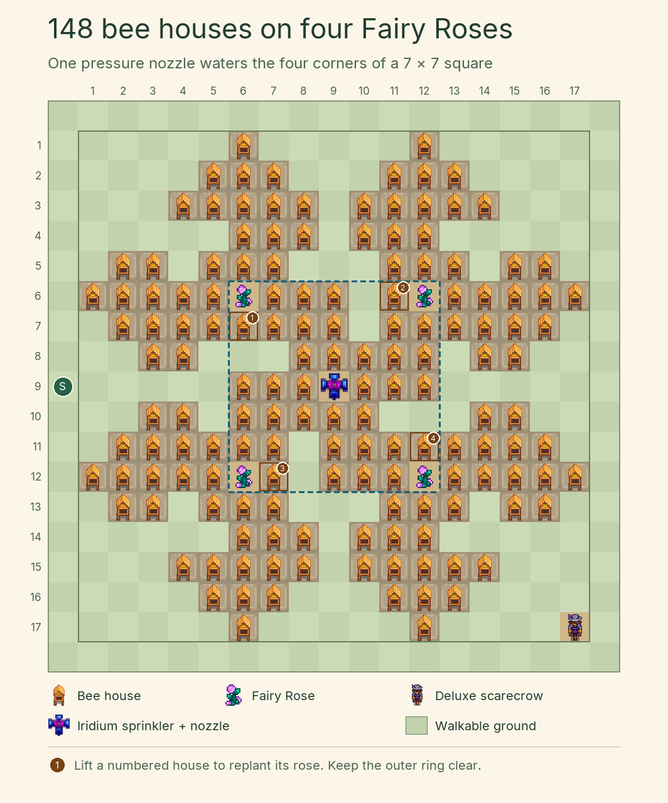
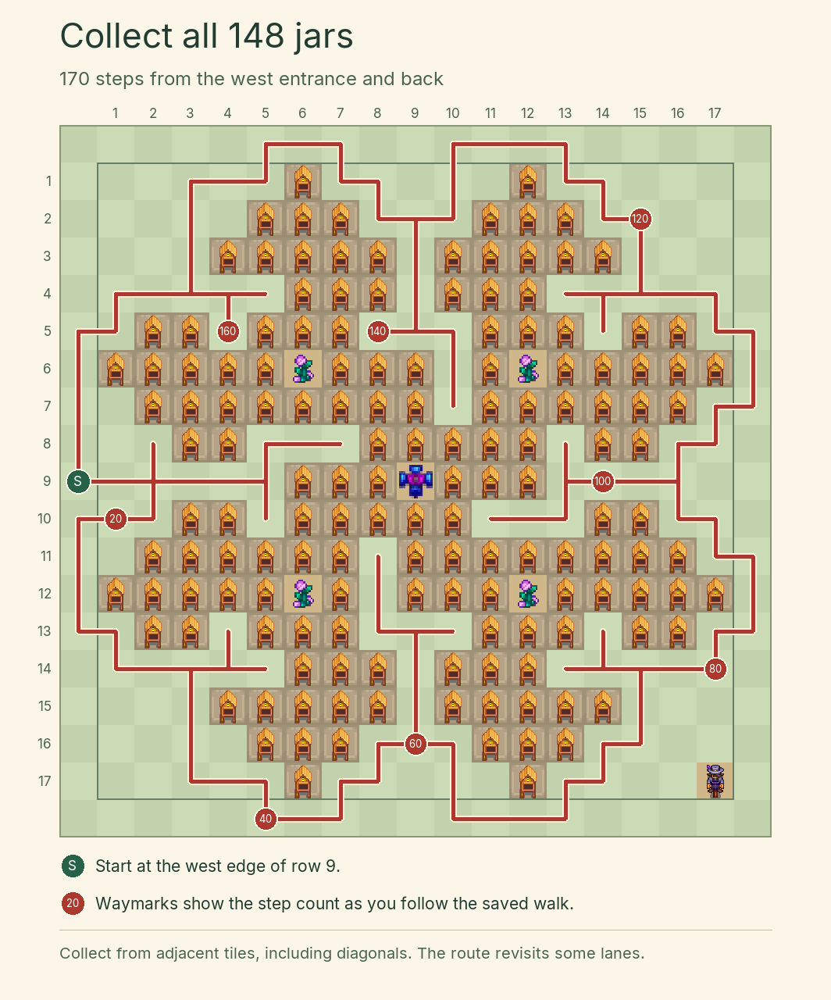
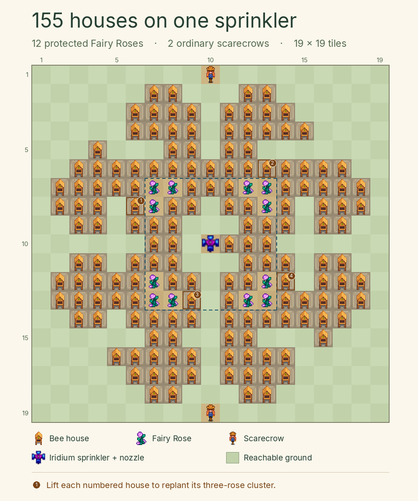
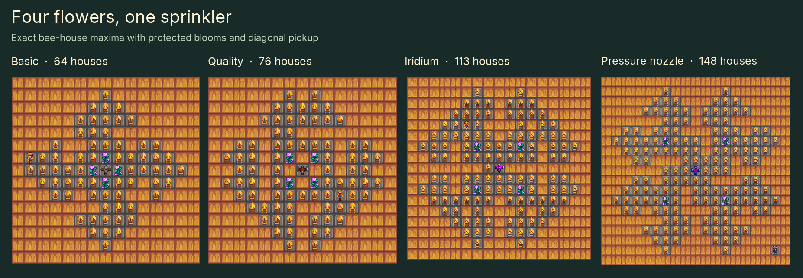

# Bee houses on one sprinkler

A pressure-nozzle iridium sprinkler gives you two ways to build. Four Fairy Roses supply **148 houses**. To reach the maximum of **155 houses**, you need twelve roses. Both plans keep every bloom out of picking range during the honey harvest. [Four-rose tile plan](nozzle-four.txt) · [Twelve-rose tile plan](layout.txt)

## 148 houses with four roses

| Build map | Collection walk |
|:---:|:---:|
| [](nozzle-four.png) | [](nozzle-four-route.png) |

1. Mark out a **17×17 plot** on sprinkler-compatible farmland. Leave a clear tile on every side, for **19×19 including the walking ring**. Count columns from the left and rows from the top of the inner plot.
2. Put an iridium sprinkler with a pressure nozzle at **(9, 9)**. Plant the roses at **(6, 6), (12, 6), (6, 12) and (12, 12)**. Place a deluxe scarecrow at **(17, 17)**. Set the houses around the planted roses using the map. [Tile-by-tile plan](nozzle-four.txt)
3. Stand on the outer ring just west of row **9**, at the green **S**. The saved walk collects all **148 jars in 170 steps** and returns to that tile. Some houses need a diagonal pickup. The compass instructions give a direction and a tile count, so `E5` means five tiles east. [Turn-by-turn walk](nozzle-four-walk.txt)
4. To replant a rose, lift the house with its numbered marker, step into the gap, replant and replace the house. The four service houses, in map order, are **(6, 7), (11, 6), (7, 12) and (12, 11)**.

The house count is the proven maximum with four protected flowers and one nozzle. The 170-step walk is one verified way to collect them.

## 155 houses with twelve roses

**155 is the most flower-honey houses a single pressure-nozzle iridium sprinkler can support while every flower stays out of picking range.** Four clusters of three Fairy Roses achieve it. All **12 roses are necessary** to reach 155 houses. The 19×19 build includes two ordinary scarecrows and all the ground needed to collect the honey. Some houses require a diagonal pickup.

[](build-map.png)

Two players published single-nozzle layouts with 155 and 160 houses. Other players described accidentally picking the flowers during collection. The protected build matches the first house count and comes within five of the second. The proof shows that keeping all 160 while shielding every flower is impossible under the rules below. [155-house player layout](https://www.reddit.com/r/StardewValley/comments/1v2bd20/new_layout_for_bee_houses_using_the/) and [160-house player layout](https://www.reddit.com/r/StardewValley/comments/lsep5q/160_bee_houses/)

### Building the 155-house layout

Place the sprinkler at **column 10, row 10**, counting from the top left. Attach the pressure nozzle and plant the 12 roses inside the dashed watering square. Install the houses around the roses after planting. Two ordinary scarecrows at **(10, 1)** and **(10, 19)** cover every flower. A single deluxe scarecrow at **(18, 18)** can replace both. In the text grid, `H` is a bee house, `F` is a Fairy Rose, `S` is the permanent sprinkler, `C` is an ordinary scarecrow and `.` is open ground. [Tile-by-tile plan](layout.txt), [pressure nozzle](https://stardewvalleywiki.com/Pressure_Nozzle) and [scarecrow coverage](https://stardewvalleywiki.com/Scarecrow)

Enter from the top-left corner. The green tiles are connected by cardinal steps. **104 houses can be collected from the side and 51 require a diagonal pickup** in this build. Each flower shares its eight neighbors only with houses and other roses in its sealed cluster. You can leave empty inventory slots while harvesting.

To replace seasonal flowers, pick up the numbered house for that cluster, step inside, replant and restore the house. Each of the four houses can itself be approached from the side.

| Mark | Rose cluster | House to lift (column, row) |
|---|---|---:|
| 1 | Northwest | (6, 8) |
| 2 | Northeast | (13, 6) |
| 3 | Southwest | (9, 13) |
| 4 | Southeast | (14, 12) |

## Every sprinkler tier

Each count below is a **global maximum** on open farmland with one permanent sprinkler and eight-direction honey collection. The first three plans each use four flowers and one ordinary scarecrow. The last column gives the proven minimum number of flowers for each house count. Bryan Low previously reached 76 houses using all eight quality-sprinkler flower positions. Four roses can supply the same 76. [Bryan Low's quality-sprinkler layout](https://blow.sg/blog/stardew-beehouse-layout)

| Permanent sprinkler | Watered tiles | Maximum houses | Minimum flowers |
|---|---:|---:|---:|
| [Basic](basic.txt) | 4 | **64** | 4 |
| [Quality](quality.txt) | 8 | **76** | 4 |
| [Iridium](iridium.txt) | 24 | **113** | 4 |
| [Iridium with pressure nozzle](layout.txt) | 48 | **155** | 12 |

**If you have only four roses**, the maximum progresses from **64 → 76 → 113 → 148** as you upgrade the sprinkler. The four-flower plans below use the same shielding rule at every tier.

[](sprinkler-tiers.png)

The sprinkler occupies its center tile and waters the flowers in place. A house needs a mature eligible flower within five Manhattan steps. The farmer walks on cardinally connected, unoccupied tiles and can collect adjacent houses diagonally. Flower protection means no reachable standing tile, including a diagonal, can put a flower within picking range. All counts have been checked computationally. An in-game playtest remains open. [Bee house mechanics](https://stardewvalleywiki.com/Bee_House) and [sprinkler patterns](https://stardewvalleywiki.com/Sprinkler)

For **side-only collection**, the exact single-sprinkler maxima for the two early tiers are **56 houses with a basic sprinkler** and **70 with a quality sprinkler**. These plans include an ordinary scarecrow and work with two and seven flowers, respectively. [56-house grid](basic-side.txt) · [70-house grid](quality-side.txt)

With an ordinary iridium sprinkler, a separate design supports **98 side-only houses** with nine flowers and one ordinary scarecrow. [98-house grid](iridium-side.txt)

## How the upper bound works

For the nozzle, 48 soil tiles can hold a watered flower. Their radius-five flower ranges contain exactly **229 candidate tiles** including the center. Any house beyond them would produce wild honey. The solver permits walking anywhere outside this region for free. It can pick any combination of watered flower tiles, use asymmetric layouts, leave unused ground or place solid fillers. It imposes no flower budget, scarecrow requirement or fixed set of passages.

For each standing tile used for collection, choose one cardinal predecessor on a route in from the exterior. The tile and its predecessor each reach a 3×3 square. The new tile can add **at most three** positions along the far edge of that square. Every house and standing tile beyond immediate exterior reach must first become reachable through one of those three-position strips. Encoding those strips gives a useful upper bound of **156** even before checking whether all of the chosen routes connect to the outside.

To enforce connected routes, every chosen standing tile consumes one unit of flow arriving through its predecessor. A disconnected group could receive no flow from outside and still need one unit per tile, which is impossible. The resulting integer program proves that **156 is infeasible**. The independent checker flood-fills the 155-house plan from the actual corner of its 19×19 grid, tests every pickup and flower, then opens each of the four marked service houses in turn. The published witness and upper bound meet at 155.

## Reproduce

CP-SAT found the 155-house placement. The fast independent checker uses Python's standard library. The upper-bound proof uses SCIP through the project's OR-Tools installation. From the repository root, run these commands. A limited run that times out reports an incomplete proof.

```sh
python examples/pressure-nozzle/verify.py
python examples/pressure-nozzle/prove.py --tier nozzle --relaxed
python examples/pressure-nozzle/prove.py --tier nozzle --seconds 600
# Verify the two early-game side-only maxima.
python examples/pressure-nozzle/prove.py --tier basic --side-only --exceed 56
python examples/pressure-nozzle/prove.py --tier quality --side-only --exceed 70
```

Replace `nozzle` with `basic`, `quality` or `iridium` to repeat the proof for another sprinkler. Add `--at-most-flowers 3` to a connected proof for any of those first three tiers to check that four roses are necessary. For the nozzle tier, use `--at-most-flowers 11` to check the twelve-rose minimum, or `--at-most-flowers 4 --exceed 148` to check the four-rose maximum. [Proof model](prove.py) and [independent build verifier](verify.py)

Stardew Valley artwork by ConcernedApe. The maps use Bryan Low’s bee house and rose sprites, the Stardew Valley Planner’s sprinkler and deluxe scarecrow, and the wiki’s ordinary scarecrow. [Bryan Low’s game sprites](https://github.com/keyute/stardew-beehouse-layout/tree/35060e2bc9881b3fccb4aad528461baeb7f5ef64/assets) · [Planner sprite atlas](https://stardew.info/planner/assets/tilesheets/sprites.png) · [Pressure-nozzle sprinkler](https://github.com/hpeinar/stardewplanner/blob/f6c8dd5fba513d78b95d491a8aa77d6532c55ee6/public/planner/img/tiles/irid-sprinkler-pressured.png) · [Ordinary scarecrow](https://stardewvalleywiki.com/File:Scarecrow.png)
