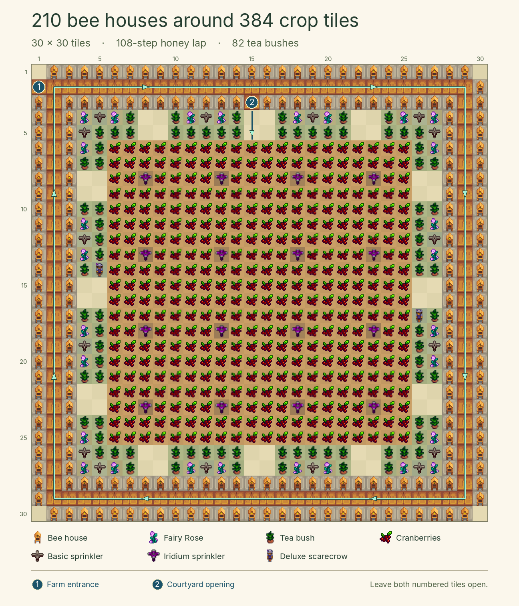
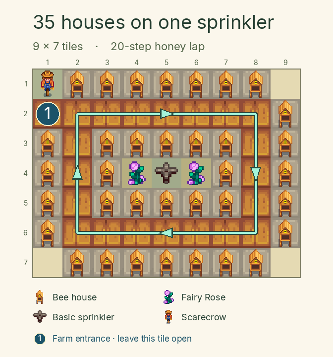
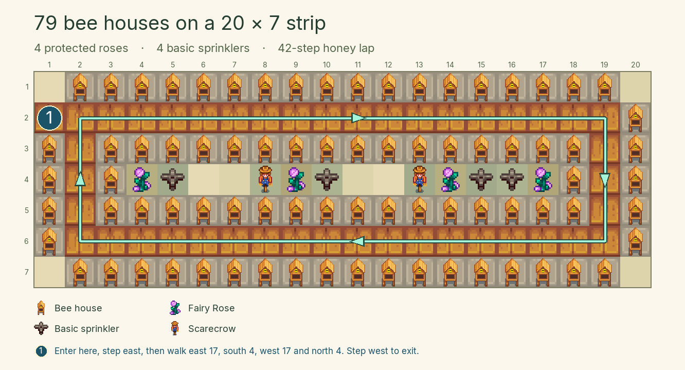

# 210 bee houses around a working crop field

Collect **210 jars of flower honey in a 108-step lap** around **384 watered crop tiles**. A permanent opening leads into the courtyard, where four rows of four iridium sprinklers water a 20×20 bed. The 82 tea bushes in the hedge keep the Fairy Roses safe to walk past and provide a third harvest. The whole build fits in **30×30** on sprinkler-compatible farmland.

[](courtyard.png)

## Build and harvest the courtyard

1. Leave both numbered tiles **empty**. Enter at **1** on the west edge and step east onto the wooden lap. Walk **east 27, south 27, west 27 and north 27**. Every bee house is directly above, below, left or right of a visited tile. The westbound step back to **1** makes **110 steps** from the farm entrance and back.
2. To tend the crops, leave the lap through **2** on the north side. Use a walkable crop such as the pictured cranberries. All 384 crop tiles are watered and reachable. The map uses two deluxe scarecrows in the hedge. With four ordinary scarecrows instead, the field holds **380 crops**. The verifier prints either build. [Iridium sprinkler coverage](https://stardewvalleywiki.com/Iridium_Sprinkler) and [scarecrow ranges](https://stardewvalleywiki.com/Scarecrow)
3. Plant the 28 Fairy Roses before placing the houses and tea bushes. Sixteen basic sprinklers water the roses. Each has solid objects on all eight neighboring tiles. To change a seasonal flower, lift the house between it and the lap, replant the flower and put the house back. Fairy Roses and cranberries can grow together in fall on the main farm. [Bee house flower range](https://stardewvalleywiki.com/Bee_House), [basic sprinkler coverage](https://stardewvalleywiki.com/Sprinkler) and [cranberries](https://stardewvalleywiki.com/Cranberries)
4. Tea bushes block walking from the moment they are planted and grow without watering. All 82 can be harvested when tea is in season. **78** have a side pickup. The four bushes just inside the corners of the hedge require a diagonal pickup. The honey lap measures honey collection alone. [Tea bush growth and harvest](https://stardewvalleywiki.com/Tea_Bush)

The [tile-by-tile plan](courtyard.txt) uses the symbols below. Flooring is optional. Both openings are ordinary standing tiles and can be left as bare ground.

| Symbol | Place on this tile | Symbol | Place on this tile |
|---|---|---|---|
| `H` | Bee house | `v` | Walkable crop |
| `F` | Fairy Rose | `T` | Tea bush |
| `S` | Basic sprinkler | `I` | Iridium sprinkler |
| `D` | Deluxe scarecrow | `C` | Ordinary scarecrow |
| `G` | West entrance | `g` | Courtyard opening |
| `+` | Honey lap | `.` | Empty ground |

## Why 108 steps is optimal

A closed cardinal walk of $L\ge12$ steps has at most **$2L-4$ distinct side-neighbors**. One must remain open to enter from the farm. A second must stay open for a lap that separates a usable courtyard from the outside. That leaves at most **$2L-6$ houses**. The square places a house on every one of the **210** available sites. The bound applies even if the walk turns more often, visits the same tile repeatedly or crosses itself. The proof and an exhaustive check through 18 steps are included. [Walking bound](proof.md)

**108 is also the minimum closed walking distance for 210 houses on any accessible layout under side-only pickup.** The next shorter possible lap has 106 steps and could serve at most 207 houses even with just one entrance. For the pictured build, starting at the west entrance adds two steps. To reach its far-right houses a walk must span 28 columns from that entrance, and the top and bottom houses require a 27-row span. Returning across both spans costs at least $2(28+27)=110$ steps. Turning and picking up items take additional game time. The counts have been checked on the grid. An in-game playtest remains open.

## Start with one sprinkler and 35 houses

On **9×7** tiles, two roses share a basic sprinkler between them. One ordinary scarecrow protects both. Enter the west opening, step east onto the lap and walk **east 6, south 4, west 6 and north 4**. That is **20 steps** on the lap, or **22** from the entrance and back. Both lengths are optimal under side-only collection. [Tile-by-tile starter](starter.txt)

[](starter.png)

A seven-tile extension adds **28 houses, two roses and one basic sprinkler**. Extend the two long lanes and move the eastern turn to the new end. The player uses a single entrance and collects everything inside the footprint.

| Plot | Houses | Roses | Basic sprinklers | Lap steps | Entrance and back |
|---|---:|---:|---:|---:|---:|
| 9×7 | 35 | 2 | 1 | 20 | 22 |
| 16×7 | 63 | 4 | 2 | 34 | 36 |
| 23×7 | 91 | 6 | 3 | 48 | 50 |
| 30×7 | 119 | 8 | 4 | 62 | 64 |
| 51×7 | 203 | 14 | 7 | 104 | 106 |

For a width $W=7r+2$, the rectangular lap has $L=2W+2$ steps. It supports **$4W-1=2L-5$ houses**, the maximum possible for an accessible lap of that length anywhere. The top row has $W-2=7r$ houses. With the lap and all its house positions filled, fully shielded in-plot flowers can grow only on the middle row. A flower reaches at most five top-row houses. A basic sprinkler can water two flowers, one immediately to either side, whose combined reach spans at most seven top-row houses. The **$r$ basic sprinklers** in the table therefore attain the minimum for this fully occupied rectangular lap.

## 79 houses in a 42-step lap

[](20x7.png)

From the west entrance, step east, then walk **east 17, south 4, west 17 and north 4**. Step west to leave. The full round trip takes 44 steps.

For a different width, the generator can minimize sprinklers or flowers first. At **20×7** it fits **79 houses in 42 lap steps**, with either **four flowers and four basic sprinklers**, or **five flowers and three sprinklers**. A published three-lane plan on the same footprint uses 68 houses, six flowers and six basic sprinklers. The earlier 78-house layout in this project has a 46-step lap. [20×7 build](20x7.txt), [published player layout](https://www.reddit.com/r/StardewValley/comments/zqd7dg/) and [earlier one-lap layout](../one-lap/README.md)

## Reproduce

From the project root, the first three commands use only Python's standard library. Add `--grid` to the courtyard commands to print the complete planting diagram. The optional last command independently certifies the strip's resource counts with OR-Tools CP-SAT.

```sh
python examples/repeating-apiary/courtyard.py --check examples/repeating-apiary/courtyard.txt
python examples/repeating-apiary/courtyard.py --ordinary
python examples/repeating-apiary/plan.py --width 51
python examples/repeating-apiary/plan.py --width 20 --priority flowers --solve
```

Stardew Valley artwork by ConcernedApe. The diagrams use sprites from [Bryan Low's collection](https://github.com/keyute/stardew-beehouse-layout/tree/35060e2bc9881b3fccb4aad528461baeb7f5ef64/assets), [Stardew Valley Planner](https://github.com/hpeinar/stardewplanner/tree/f6c8dd5fba513d78b95d491a8aa77d6532c55ee6/public/planner/img/tiles) and the wiki's [basic sprinkler](https://stardewvalleywiki.com/File:Sprinkler.png) and [ordinary scarecrow](https://stardewvalleywiki.com/File:Scarecrow.png).
