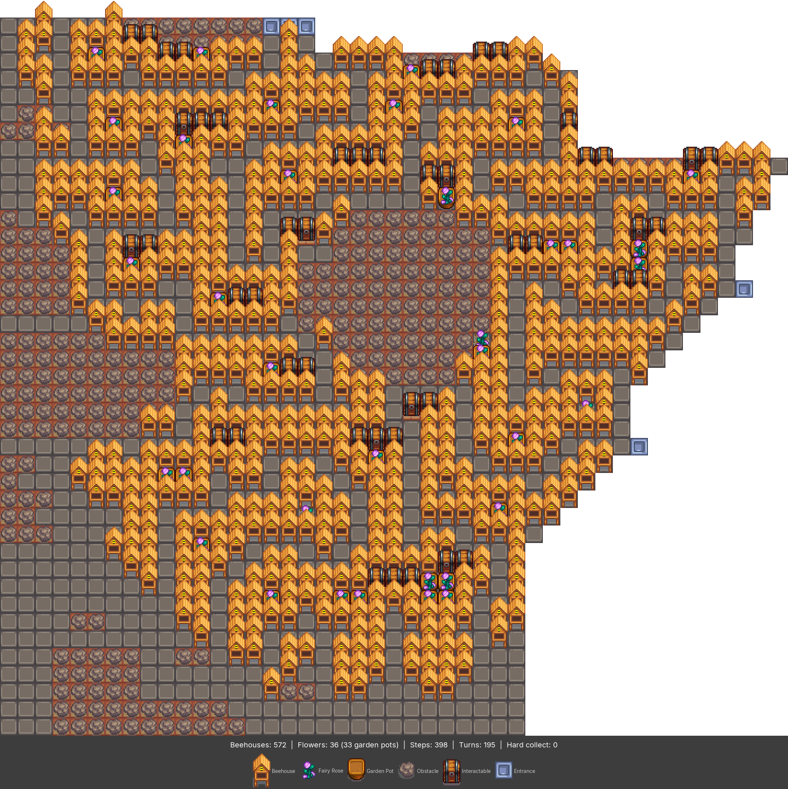

# 572 jars in a 398-step harvest

Start at the northern entrance to Ginger Island’s west bank, collect **572 jars of Fairy Rose Honey** and return in **398 tile steps**. Bryan Low’s published 571-house build on the same terrain has a 742-step harvest walk. This build produces one extra jar, uses eight fewer garden pots and saves **344 steps per harvest (46%)**. With Artisan, its 572 jars sell for **544,544g**. [Published layout and route](https://blow.sg/blog/stardew-beehouse-layout)

| West-bank build | Houses | Roses | Garden pots | Closed-walk steps |
|---|---:|---:|---:|---:|
| Published reference, eastern bridge | 571 | 46 | 41 | 742 |
| Same reference, shortest tour from our northern gate | 571 | 46 | 41 | **744** |
| [600-house build](../ginger-island/README.md), shortest tour | 600 | 29 | 24 | 756 |
| **Short harvest** | **572** | **36** | **33** | **398** |
| [Alternative 600-house layout](shorter-600.txt), [shortest tour](shorter-600-walk.txt) | 600 | 32 | 27 | 718 |
| High yield with a shorter tour | 593 | 37 | 32 | 548 |
| Single lap, every standing tile visited once | 537 | 28 | 24 | 366 |
| Side pickups only | 526 | 42 | 40 | 458 |

| Build map | Collection route |
|:---:|:---:|
| [](build-map.png) | [](harvest-route.png) |

## Building and collecting

Find the west-bank pond and the two eastern bridges. Start at the leftmost northern entrance, column 16, row 1. Plant **three roses in soil and 33 in garden pots** before placing the houses. Leave the mature roses planted. Deluxe Retaining Soil and an initial watering can keep the enclosed beds watered. Potted flowers supply honey in Stardew Valley 1.6.6 and later. [In-game survey overlay](https://blow.sg/blog/stardew-beehouse-layout/ginger-island-overlay-verified.png) · [Garden pot watering](https://stardewvalleywiki.com/Garden_Pot) · [Bee House version history](https://stardewvalleywiki.com/Bee_House)

Collect from the green **S**, then from the 159 numbered stops in order. The route uses 361 distinct standing tiles and returns to **S**. In the tile plan, `B` is a bee house, `F` a soil-grown rose and `f` a potted rose. Walk tokens give a compass direction and number of tiles, so `E2` means two tiles east. [Tile plan](harvest.txt) · [Complete walk](harvest-walk.txt)

All five entrances remain connected. Every house has a bloom within five tiles by Manhattan distance. Each rose is shielded from all eight sides, including at the mapped boundary. On the 398-step route, 122 houses require a diagonal pickup. Such pickups qualify only when the standing tile has no adjacent interactable obstruction under the reference study’s controller rule. Steps measure cardinal movement. Turning, pickup actions and the journey to the entrance add playing time. These layouts and walks are computationally verified. An in-game playtest remains open.

## Other ways to collect

- **Keep all 600 houses.** Three additional pots let the redesigned 600-house build finish in 718 steps, saving 38 steps against the old layout’s shortest possible walk from the same northern gate. The new route also attains its fixed-layout lower bound. [Build map](shorter-600.png) · [Route map](shorter-600-route.png) · [Tile plan](shorter-600.txt) · [Complete walk](shorter-600-walk.txt)
- **Near the 600-house yield.** The high-yield plan gives 593 jars in 548 steps, seven jars below the 600-house build with 208 fewer steps per full harvest. It uses five soil roses and 32 pots, eight more pots than the 600-house build. [Route map](high-yield-route.png) · [Tile plan](high-yield.txt) · [Complete walk](high-yield-walk.txt)
- **One continuous lap.** The 537-house plan uses four soil roses and 24 pots. Follow the loop for 366 steps. You visit every standing tile exactly once before returning to the start, with no junction to retrace. A full harvest is worth **511,224g** with Artisan at 952g per jar. [Route map](single-lap-route.png) · [Tile plan](single-lap.txt) · [Complete walk](single-lap-walk.txt) · [Honey prices](https://stardewvalleywiki.com/Honey)
- **Side pickups only.** Collect 526 jars by facing directly north, south, east or west. This build uses two soil roses and 40 pots and takes 458 steps. The previous 545-house side-only map needs at least 722 steps to collect any 526 jars from the same gate, even if you choose which houses to skip. [Route map](side-only-route.png) · [Tile plan](side-only.txt) · [Complete walk](side-only-walk.txt) · [545-house build](../ginger-island/side-only/README.md)

## Why changing the map saves walking

The published 571-house map has **322 separate links** where cutting that one connection puts at least one house’s every pickup position on the far side of the cut. A round trip must cross each link in both directions, accounting for 644 steps before counting movement within the remaining areas. On the 572-house map only **36** links force this kind of return crossing.

On the decoded 571-house map, the shortest full tour from our northern gate takes **exactly 744 steps**. An excursion across a bridge returns to the same tile. Removing those excursions leaves closed walks inside the areas between bridges. In three of those areas the walk must connect multiple compulsory tiles, costing another 92, 4 and 4 steps. A matching 744-step walk collects every jar. The new map therefore saves **346 steps** from the same gate.

Low's published route starts at the lower eastern bridge, column 37, row 25, and reports 742 steps. From that gate our independent shortest walk for his layout takes **740 steps**, with 320 compulsory links and the same 100 steps inside the three areas. We reconstructed his published walk by reading its 307 numbered stops in order and connecting them along the 401 painted tile links. The replay also matches the 336 turns printed in its caption. [Published route with the green starting marker](https://blow.sg/blog/stardew-beehouse-layout/ginger-island-layout-no-hard-route.png) · [Published walk](published-walk.txt) · [Shortest northern walk](reference-north-walk.txt) · [Shortest eastern walk](reference-east-walk.txt)

On our earlier 600-house build, even collecting any **571** houses from the northern gate takes **at least 620 steps**. This CP-SAT bound allows the player to choose which houses to skip. Collecting all 600 takes at least 756 steps, and our [756-step walk](600-shortest-walk.txt) attains that bound. The earlier 545-house side-only map’s 868-step full harvest also attains its bound. All of these bounds concern fixed layouts. The global optimum for designing a new apiary remains open.

## Reproduce

Run these commands from the repository root. The replay checks placement, flower coverage, protection, connected entrances and pickup access along the supplied movements.

```sh
d=examples/short-harvest
python "$d/verify.py"
python "$d/reference.py"
python "$d/compare.py" examples/ginger-island/600-houses.txt 571
python "$d/compare.py" examples/ginger-island/side-only/545-houses.txt 526 --side-only
```

The reference verifier reads the [decoded 571-house grid](reference-571.txt), replays the published walk and both gate-specific alternatives, and proves the minima by removing bridges and solving the small traveling-salesman problems on compulsory pickup and bridge-end tiles within each remaining area. To check an independent decode, follow the [west-bank conversion instructions](../ginger-island/README.md) and pass the resulting grid to `reference.py`.

For partial-harvest comparisons, `compare.py` models each undirected tile connection with zero, one or two crossings. Each visited tile has even degree, and every used bridge leads back toward the entrance. The relaxation can admit disconnected movement within a block of tiles linked by cycles, which makes its minimum a lower bound. Adding `--tighten` cuts off disconnected solutions until the time limit or a connected optimum. Two crossings suffice in a shortest walk because removing a pair of surplus crossings from any edge used three or more times preserves parity and connectivity.

The neighborhood search chooses house and flower placements together with crossings. It requires one connected closed walk through valid pickup positions. The optional single-lap rule gives each visited tile exactly two incident edges. The flower and pot budgets default to those of the supplied layout.

```sh
python examples/short-harvest/improve.py examples/short-harvest/single-lap.txt \
  examples/short-harvest/single-lap-walk.txt /tmp/island-lap --one-lap --passes 3
```

Stardew Valley artwork by ConcernedApe. The maps use Bryan Low’s terrain transcription, sprites and renderer. [Reference repository](https://github.com/keyute/stardew-beehouse-layout/tree/35060e2bc9881b3fccb4aad528461baeb7f5ef64) · [Terrain license](../ginger-island/TERRAIN-LICENSE)
