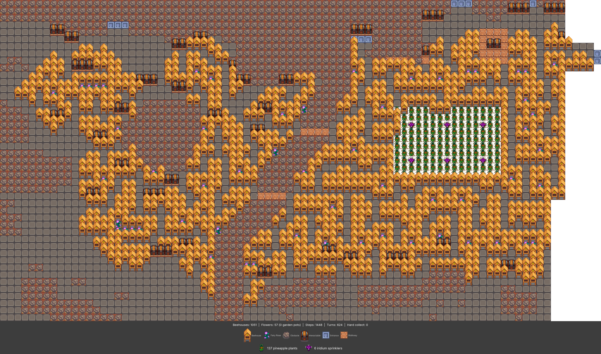
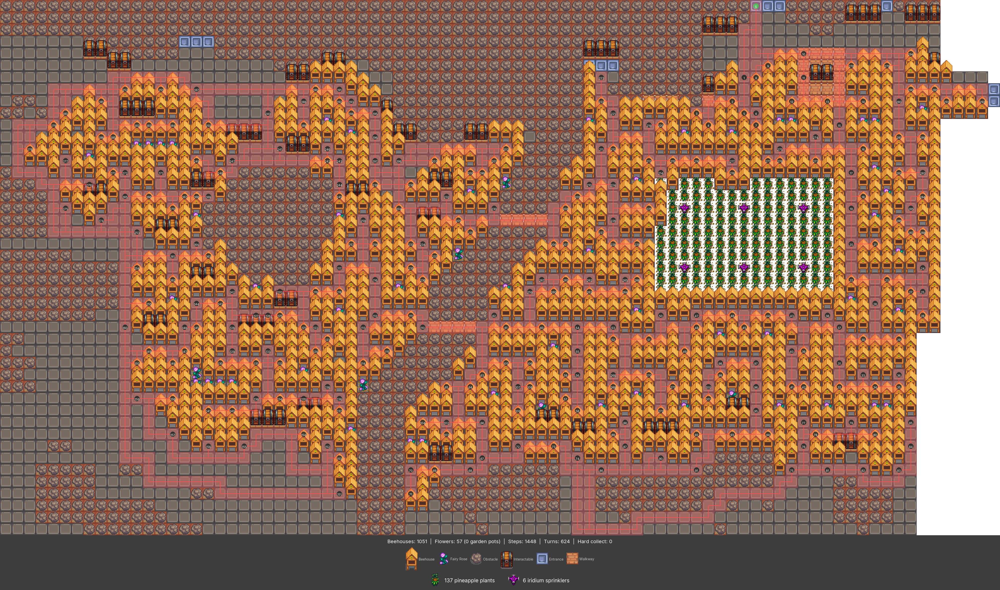

# A million-gold honey harvest with zero garden pots

Plant **57 Fairy Roses directly in the soil** on southern Ginger Island West. They support **1,051 bee houses** and leave room for **137 sprinkler-watered pineapples**. With Artisan, a full harvest of Fairy Rose Honey sells for **1,000,552g**. The collection walk returns to the entrance without crossing a single crop or sprinkler tile. [Honey price and production](https://stardewvalleywiki.com/Honey)

| Build map | Honey collection walk |
|:---:|:---:|
| [](build-map.png) | [](harvest-route.png) |

| Build | Houses | Artisan honey sales | Garden pots | Irrigated crops | Standard iridium sprinklers |
|---|---:|---:|---:|---:|---:|
| [Soil-grown roses](farm.txt) | 1,051 | 1,000,552g | 0 | 137 | 6 |
| [20-pot 25×20 field](twenty-pots/farm.txt) | 1,002 | 953,904g | 20 | 480 | 20 |
| [40-pot 25×20 field](fewer-pots/farm.txt) | 1,051 | 1,000,552g | 40 | 480 | 20 |
| [Previous 25×20 field](../mixed-farm/README.md) | 1,051 | 1,000,552g | 42 | 480 | 20 |

## A 480-crop field with garden pots

With 20 pots you can keep all 480 pineapples and earn **95.3%** of the larger build’s honey income. The 1,002-house layout uses 32 soil-grown roses and 20 potted roses. [Build map](twenty-pots/build-map.png) · [Route map](twenty-pots/harvest-route.png) · [1,426-step walk](twenty-pots/harvest-walk.txt)

The [40-pot build map](fewer-pots/build-map.png) keeps the previous field and all twenty sprinkler positions. Its 59 protected roses include 19 planted directly in soil. The [route map](fewer-pots/harvest-route.png) and [1,342-step walk](fewer-pots/harvest-walk.txt) cover all 1,051 houses. An earlier player also demonstrated a million-gold layout in-game on a different footprint. Their post gives no comparable irrigated crop count. [Player’s original build](https://www.reddit.com/r/StardewValley/comments/1e99h1f/)

## Building the soil-grown farm

Use the [tile grid](farm.txt) against the [combined terrain survey](../mixed-farm/terrain.txt). The upper-left tile is column 1, row 1. Plant each `F` on tilled soil, water the flowers and let them mature before closing the beds with the houses marked `B`. Deluxe Retaining Soil can carry a flower to maturity from its first watering. Every house is within five cardinal tiles of a Fairy Rose. Houses, neighboring roses and terrain shield all eight sides of each flower. [Deluxe Retaining Soil](https://stardewvalleywiki.com/Deluxe_Retaining_Soil)

Place standard iridium sprinklers at columns **58, 63 and 68**, on both rows **18 and 23**. Their combined footprint spans columns 56–70 and rows 16–25. Plant pineapples on the 137 `C` tiles. Seven houses occupy the west and north edges of this rectangle. Start the [1,448-step collection walk](harvest-walk.txt) at column 64, row 1. Each of the 12 marked entrances stays connected. There are 261 houses with only a diagonal pickup, and all have a controller-friendly standing tile under the reference rules.

We started with a west-bank soil-grown apiary and reserved six sprinkler squares east of the river. CP-SAT rearranged overlapping windows of houses and roses. Changing the walk near the field let seven boundary tiles switch from plants to honey production. The layout passed the mixed-farm verifier and Bryan Low’s independent zero-hard-collect validator, on both the original terrain and the terrain with the whole crop field blocked. The crop harvest check lets the player walk through pineapples with the sprinklers in place. The map is a hand-transcribed survey. NPC schedules and collection time have not been tested in-game. [Reference validator and map](https://github.com/keyute/stardew-beehouse-layout/tree/35060e2bc9881b3fccb4aad528461baeb7f5ef64)

## Why the 480-crop field needs pots

A checkable linear-programming certificate limits **any zero-pot million-gold honey build to 259 irrigated plants**, across the whole survey. A second certificate proves that the published 480-crop rectangle requires **at least six pots** at the same honey target. The best plant count and minimum pot count remain open. The [certificate checker](field_bound.py) verifies signed row weights using integer arithmetic. The resulting bounds are 259.558550 plants from above and 5.531541 pots from below. Both counts have to be whole numbers.

A shorter geometric argument limits any protected zero-pot farm with at least 1,051 houses to **332 irrigated plants** on this survey, even if the crops are scattered. For the published 25×20 rectangle in its exact position, the same argument gives **at most 934 houses**. Trying all 17 legal origins for a 25×20 all-soil rectangle gives at most **950 houses**.

To see the counting argument, mark every house or flower tile within five of an eligible native rose. There are 1,849 such tiles. Of these, 1,657 have no neighboring walkable tile outside the marked area. Give the player free use of all walkable exterior ground. On a four-direction collection walk, moving one tile adds at most three cells to the 3×3 pickup square. If the walk enters `R` distinct marked tiles, it can cover at most `1,849 − 1,657 + 3R` marked tiles. These must include the houses and the `R` walking tiles themselves. At 1,051 houses there must also be at least 22 roses, since each can serve at most 48 houses. This leaves at most **346 tiles for crops plus sprinklers**. Each ordinary iridium sprinkler can support at most 24 plants. The [counting script](upper_bound.py) recalculates all of these bounds from the terrain. [One-rose maximum](../open-field.md#how-the-grid-size-changes-the-answer)

The linear model gives every house a flower and a pickup, reserves each rose’s neighbors for shielding, enforces sprinkler range, and counts which houses a four-direction walk can bring into reach. It allows fractional placements, so every playable farm must satisfy its constraints. The certificates can be replayed without running a search. From the repository root, run the following commands.

```sh
d=examples/soil-only-million
python mixed_farm.py examples/mixed-farm/terrain.txt "$d/farm.txt" --walk "$d/harvest-walk.txt"
python mixed_farm.py examples/mixed-farm/terrain.txt "$d/fewer-pots/farm.txt" --walk "$d/fewer-pots/harvest-walk.txt"
python mixed_farm.py examples/mixed-farm/terrain.txt "$d/twenty-pots/farm.txt" --walk "$d/twenty-pots/harvest-walk.txt"
python "$d/upper_bound.py"
python "$d/field_bound.py"
python "$d/field_bound.py" --pots
```

Terrain and renderer by Bryan Low, based on iaia_'s terrain survey. Game artwork by ConcernedApe. [Terrain license](../mixed-farm/TERRAIN-LICENSE) · [Original in-game survey](https://www.reddit.com/r/StardewValley/comments/1k5rod1/all_plantable_areas_on_ginger_island_farm/) · [Pineapple sprite](https://stardewvalleywiki.com/File:Pineapple_Stage_6.png) · [Sprinkler sprite](https://stardewvalleywiki.com/File:Iridium_Sprinkler.png)
