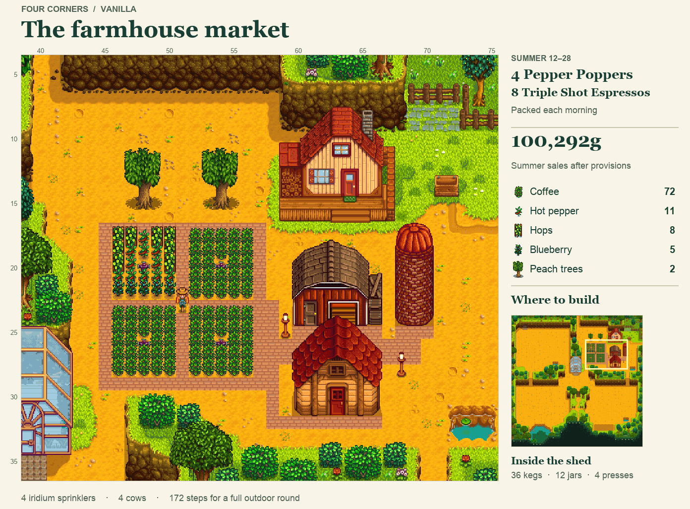
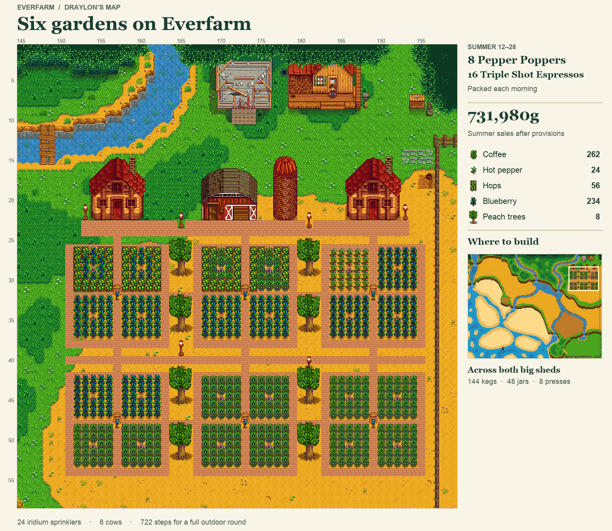

# Summer market gardens

Grow lunch for the mines and sell the rest. Every morning from **Summer 12 through 28**, each person gets a Pepper Poppers and two Triple Shot Espressos. The pepper and cheese make a meal with +1 Speed and +2 Farming. A drink adds another +1 Speed, and the second espresso can refresh it later. Coffee and pale ale compete for the same kegs, so provisioning an extra farmer changes what pays to plant. [Pepper Poppers](https://stardewvalleywiki.com/Pepper_Poppers) · [Triple Shot Espresso](https://stardewvalleywiki.com/Triple_Shot_Espresso) · [Food and drink buffs](https://stardewvalleywiki.com/Buffs)

| Summer plan | Four Corners | Everfarm |
|---|---:|---:|
| People provisioned | 4 | 8 |
| Coffee / hot pepper plants | 72 / 11 | 262 / 24 |
| Hops / blueberry plants | 8 / 5 | 56 / 234 |
| Mature peach trees / milk cows | 2 / 4 | 8 / 8 |
| Iridium sprinklers / ordinary scarecrows | 4 / 1 | 24 / 6 |
| Kegs / preserves jars / cheese presses | 36 / 12 / 4 | 144 / 48 / 8 |
| Poppers / triple espressos packed over summer | **68 / 136** | **136 / 272** |
| Maximum gross sales after packing | **100,292g** | **731,980g** |

The sales figures value everything available to ship by the last morning at regular quality with Tiller and Artisan. The beds start from seed. The orchard, barn and workshops are already established. The seed stock, buildings, hay and work are inputs, so the figures measure gross revenue. [Printable planting and workshop sheets for both maps](build-sheets.pdf)

## Four Corners farmhouse market

[](four-corners-map.png)

The whole build fits in the farmhouse quadrant between **(45, 15)** and **(70, 32)**. Three beds grow nothing but coffee. The fourth holds all 11 peppers, eight hop trellises and five blueberries. Plant a pair of peach trees along the north edge. Keep a barn and a shed on the east side so the other three quadrants stay available for the rest of the farm. Coordinates start at (0, 0) in the northwest. [Outdoor tile grid](four-corners-farm.txt) · [Shed interior](four-corners-D.txt)

On Summer 11 the first coffee harvest gives at least 288 beans. Load 31 kegs with coffee. On Summer 12, turn 24 of those coffees into eight espressos, cook four poppers, then start 25 coffees and eight pale ales. The calendar balances the rest of summer and leaves **98 pale ales, 40 cheeses, 12 peach wines and 38 peach jellies** among the goods to ship. [Four Corners morning checklist](four-corners-calendar.csv)

**For a solo save**, use the same buildings and trees. The optimum changes to **62 coffee, three peppers, 18 hops and 13 blueberries**. One meal and two espressos per day leave **202,580g** of summer sales. If you already have food and drinks, setting the order to zero switches the field to 36 hops and 60 blueberries for **234,266g**. Each scenario uses the same morning machine visits and prices.

**To start with one bed**, plant 17 coffee, three peppers and four blueberries around one iridium sprinkler. One cow, one press, six kegs and two jars supply all **17 lunches and 34 espressos**, plus **9,891g** to ship. This version works before you own any fruit trees. All six kegs brew coffee each morning from Summer 11 through 27. [One-bed solo calendar](one-bed-calendar.csv)

## Six gardens on Everfarm

[](everfarm-map.png)

Place the big barn and both big sheds along the promenade south of the farmhouse, then lay out **six 13×13 gardens** below it. The orchard runs in two avenues between them. The build spans **(151, 19)** to **(195, 54)** on Draylon’s map. Workshop D takes 44 kegs, all 48 jars and eight presses. Workshop T is a brewery with 100 kegs. [Everfarm mod](https://www.nexusmods.com/stardewvalley/mods/9347) · [Outdoor tile grid](everfarm-farm.txt) · [Workshop D](everfarm-D.txt) · [Workshop T](everfarm-T.txt)

This is the co-op-sized harvest. On Summer 11, 262 coffee plants yield at least **1,048 beans**. On Summer 12, put **80 coffees and 56 pale ales** into the kegs while eight people take their provisions. Over summer, the sale stock includes **804 pale ales, 2,712 raw blueberries, 48 peach wines and 152 peach jellies**. Assigning one person to the workshops and sharing the picking makes particular sense on coffee days. [Everfarm morning checklist](everfarm-calendar.csv)

## Build and run a summer

1. **Prepare in spring.** Plant the peach saplings with their surrounding eight tiles clear early enough to bear fruit on Summer 1. Have the mature cows, workshops, machines, a kitchen, both cooking recipes, and the seed quantities in the table ready. Shane sends the poppers recipe at three hearts. Gus sells the espresso recipe for 5,000g. Save coffee beans from an earlier harvest to plant at this scale. A full silo holds 240 hay. Budget 112 for Four Corners or 224 for Everfarm and feed the cows each day. The worksheets assume a normal fruit and milk supply every morning, including Summer 1. [Peach trees](https://stardewvalleywiki.com/Peach_Tree) · [Cows](https://stardewvalleywiki.com/Cow) · [Silo](https://stardewvalleywiki.com/Silo) · [Coffee beans](https://stardewvalleywiki.com/Coffee_Bean)
2. **Copy the beds and workshops from the printable sheets.** Plant and water all seeds on Summer 1. Each sprinkler waters a 5×5 bed, and each scarecrow covers four beds. Keep the path through the hop trellises open. The colored tile letters on both sheets stay visible where a canopy hides an object in the illustrated map. If playing multiplayer, use existing cabins or place them outside the market and its approaches. [Printable build sheets](build-sheets.pdf) · [Iridium sprinkler](https://stardewvalleywiki.com/Iridium_Sprinkler) · [Scarecrow](https://stardewvalleywiki.com/Scarecrow)
3. **Read one CSV row each morning.** Harvest that day’s crops, shake the peach trees, milk and feed the cows, and collect finished batches. Cook the orders, then load the indicated number of each product. One coffee load takes five beans of one quality. One espresso takes three coffees. Store surplus ingredients between days, then ship the remaining inventory on Summer 28. Presses and coffee kegs get one visit per morning even though both can finish sooner. The calendar includes fruit wines, jellies, pickled hops, pale ale and cheese. [Keg](https://stardewvalleywiki.com/Keg) · [Preserves jar](https://stardewvalleywiki.com/Preserves_Jar) · [Cheese press](https://stardewvalleywiki.com/Cheese_Press)

| Checked walk, out and back | Four Corners | Everfarm |
|---|---:|---:|
| Farmhouse yard to building fronts only | 68 tiles | 106 tiles |
| Farmhouse yard to every crop, tree and building front | 172 tiles | 722 tiles |
| Every machine from its shed entrance | 72 tiles | 146 tiles in each shed |

These are replayed walking routes. Every target has a side pickup. Indoor routes can be added to either outdoor route. The lengths count movement only. Milking, aiming, loading the machines and cooking take additional time. Both estates await an in-game timing trial. In particular, 576 plants and 200 machines make Everfarm a substantial job. [Four Corners directions](four-corners-walks.txt) · [Everfarm directions](everfarm-walks.txt)

## Change the orders or equipment

From the repository root with the project requirements installed, print a saved plan, re-solve it, or produce a custom calendar and matching tile plan.

```sh
python market_garden.py everfarm
python market_garden.py everfarm --solve
python market_garden.py four-corners --crew 1 --output /tmp/solo-market.json --calendar > /tmp/solo-market.csv
python examples/summer-market/layout.py four-corners --plan /tmp/solo-market.json --build /tmp/solo-market
python market_garden.py four-corners --crew 1 --sprinklers 1 --cows 1 --kegs 6 --jars 2 --presses 1 --peaches 0
```

Change the number of people with `--crew` and the triple espressos per person with `--shots`. Set your resources with `--sprinklers`, `--peaches`, `--cows`, `--kegs`, `--jars` and `--presses`. The production solver accepts fresh budgets. The placement tool fits a resulting plan into the pictured estate when its beds, orchard, barn and workshops have room. Run either check below to replay the original plan offline. [Production optimizer](../../market_garden.py) · [Placement and walk checker](layout.py)

```sh
python examples/summer-market/layout.py four-corners
python examples/summer-market/layout.py everfarm
```

## What the optimum covers

The production model chooses whole plant counts and daily machine starts for the four summer field crops in the table, together with the fixed peach and dairy supply. Each day carries ingredients and finished goods forward, reserves every machine for its full batch, and enforces that morning’s meal order. The horizon runs from an empty pantry and empty machines on Summer 1 to goods ready on the morning of Summer 28. The field follows ordinary growth with daily water, minimum guaranteed harvest counts, no fertilizer or speed modifiers, and a healthy orchard. The model excludes keg refills later in the day and values bonus harvests and quality premiums at zero. [Coffee](https://stardewvalleywiki.com/Coffee_Bean) · [Hot pepper](https://stardewvalleywiki.com/Hot_Pepper) · [Hops](https://stardewvalleywiki.com/Hops) · [Blueberry](https://stardewvalleywiki.com/Blueberry) · [Peach](https://stardewvalleywiki.com/Peach)

The coffee calendar also works with mixed crop qualities. At most four beans per quality can be left over after making all available five-bean batches. With three possible qualities, eight spare beans guarantee the requested batch count. For example, if there were at most nine batches available, the three stacks together could hold at most 45 + 12 = 57 beans. Having 58 guarantees ten batches. The solver enforces this reserve cumulatively from the first brew. [Coffee ingredients](https://stardewvalleywiki.com/Coffee)

CP-SAT’s sales upper bounds were **100,292g** and **731,980g** even before imposing terrain constraints. The published maps and calendars reach both bounds. A second solve groups the crops into as few bed-and-crop combinations as possible for each fixed planting mix and trellis pattern. Four Corners needs six combinations across four beds. Everfarm needs 28 across 24 beds. The placement checker separately tests native soil, clear fruit-tree growth squares, irrigation, scarecrows, solid buildings, workshop capacity and cardinal access. The roads and return walks were chosen for playability. [Four Corners solution](four-corners.json) · [Everfarm solution](everfarm.json) · [Four Corners terrain](../four-corners/terrain.txt) · [Everfarm terrain](../boardwalk-apiary/everfarm-terrain.txt) · [Side-access shed layouts](../machine-rooms/README.md)

Stardew Valley artwork by ConcernedApe. Everfarm by Draylon. Terrain and sprites via Henrik Peinar’s Stardew Valley Planner. To reproduce the illustrations with Pillow installed, run `python examples/summer-market/render.py --assets /tmp/market-art`. The first render downloads the artwork. [Four Corners summer map](https://stardew.info/planner/assets/farms/farm_fourcorners_summer.png) · [Everfarm source map](https://github.com/hpeinar/stardewplanner/blob/f6c8dd5fba513d78b95d491a8aa77d6532c55ee6/public/planner/img/layouts/everfarm.jpg) · [Sprite atlas](https://stardew.info/planner/assets/tilesheets/sprites.png)
